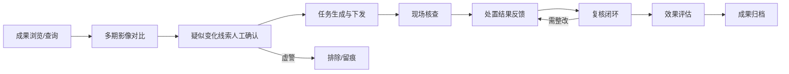
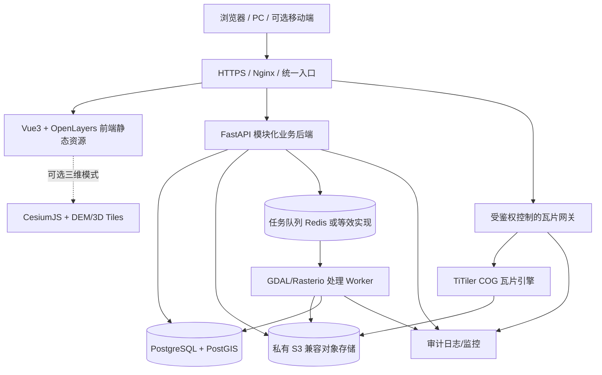
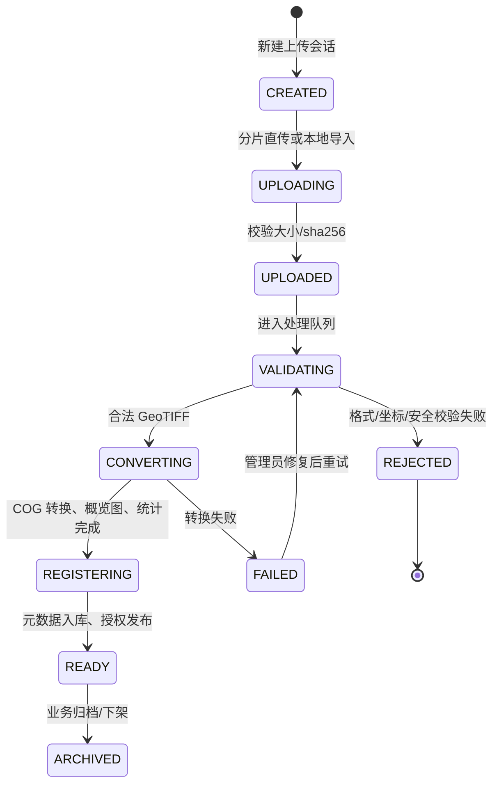
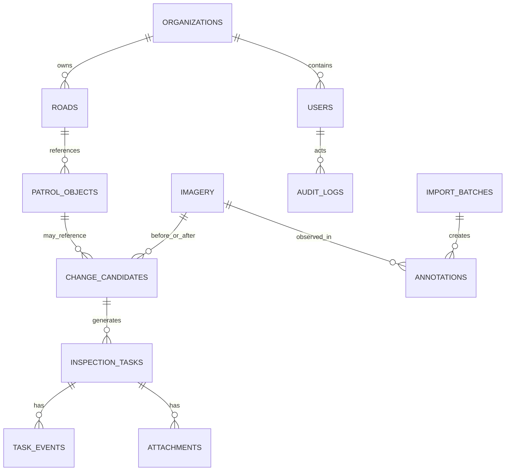
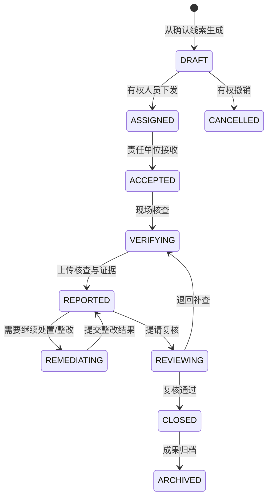
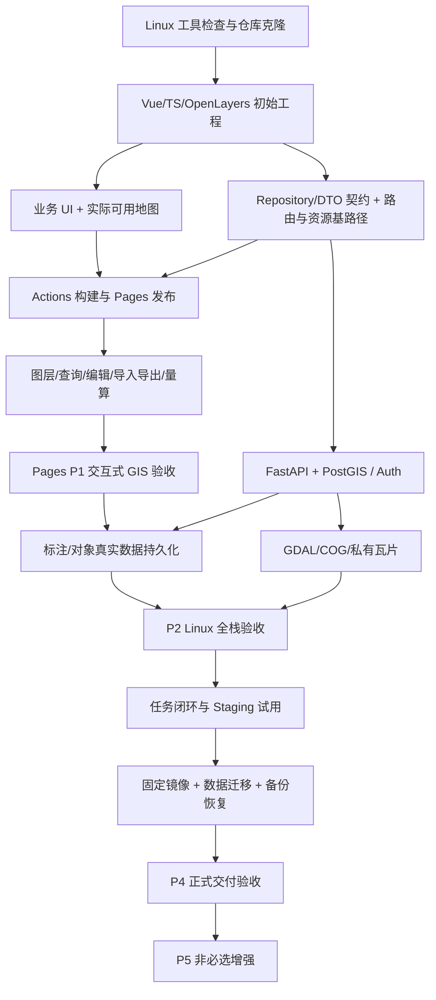

# GISTable 公路遥感监测与巡查执法管理平台

## 完整系统架构与分阶段实施执行规范（Architecture & Execution Plan）

> **文档版本**：v1.1（GitHub 优先交互展示 / Linux 直接开发 / 可迁移交付基线）  
> **修订日期**：2026-11-07  
> **上一版本**：v1.0（2026-11-07）  
> **目标仓库**：https://github.com/KtimXFGit/GISTable  
> **预期 GitHub Pages 地址**：https://ktimxfgit.github.io/GISTable/（地址仅是发布计划，**并非已部署成功**）  
> **需求依据**：v1.0 对《系统技术规范.docx》的需求分解；原始规范条款及合同范围仍需对照核验  
> **当前优先级**：先在 Linux 执行环境构建一套真实可交互、可通过 GitHub Pages 展示的 WebGIS；在不显著增加后续接入后端、部署和交付成本的前提下迭代完善。  
> **性质**：执行规范和架构决策，不代表程序已经开发、发布、测试或交付。

### v1.0 → v1.1 变更摘要

1. **调整开发先后**：由“静态 GIS 全部完成后才开始后端”改为“GitHub Pages 尽快发布 + 数据访问契约先行 + 后端按真实业务闭环接入”。**首个上线不依赖 Docker/GDAL**，但保留未来的容器化交付路径。
2. **开发环境切换**：当前任务在现有 Linux 环境中直接执行；Windows 11 + WSL2 + Docker 是用户本机后续协同开发方案，而非阻挡当前工作的前置条件。
3. **新增用户可见界面红线**：客户访问的网页不出现“演示版/演示模式/待开发/功能规划/接口未接入/技术验证/静态模拟数据”等开发说明，不出现假登录、假保存、假审批、死按钮或不具备真实动作的装饰性功能。文档与研发工具允许描述技术状态，**客户界面不允许**。
4. **平台演示策略**：GitHub Pages 作为最优先的公开交互展示入口；有真实私有数据和协作流程需求时，再上线独立的受控 Staging/UAT 环境。两者共享业务组件、布局和类型契约，而非维护两套前端。
5. **部署工程提前规划**：统一 base path、路由策略、资源路径、API client、存储接口、部署配置和版本管理，避免后续为迁移到 Linux 服务器而重写前端。
6. **范围与验收修正**：技术规范中的“必选三维/高程/贴地量算”不得因为安排在高级阶段而自动变成可选；须在最终合同交付里程碑前完成。
7. **新增直接可执行的阶段任务与自动化验收**：P0/P1 明确 Pages 展示的真实功能、禁止出现的 UI 文案、测试方式、Linux 命令和 GitHub Actions 发布要求。

---

# 0. 执行摘要与不可变原则

## 0.1 核心目标与总体技术路线

采用**单仓库 Monorepo + Vue3/TypeScript/OpenLayers 前端 + 数据访问适配层 + 后续 FastAPI 模块化单体 + PostgreSQL/PostGIS + GDAL/COG + 按需 TiTiler + 可替换存储**。先跑通可交互的浏览器产品，再分批接入持久化与正式业务，保持单套前端工程。

**优先级顺序**：

1. **尽早发布可操作的 GitHub Pages 网页**，用户看到的是完整业务界面与真实可运行的已完成操作（底图、图层、属性查询、绘制、测量、导入、导出等按阶段交付），而非技术说明页面。
2. **确保后续不返工**：先定义业务对象类型、数据接口和地图模块边界；静态数据源与 API 数据源实现同一接口；不用页面组件直接读取 `*.geojson`、写死仓库路径或调用将来才有的业务端点。
3. **由当前 Linux 环境直接完成 P0/P1**。以后在 Windows 电脑用 WSL2/VS Code 开发，沿用同仓库、同命令、同锁文件，不建设另一套 Windows 业务实现。
4. **后端能力边开发边接入**：需要服务器才能真实执行的登录、跨用户保存、上传、权限和任务流转，只在后端实际实现并通过验收后对用户开放。
5. **以可复现版本交付**：后续通过 Docker Compose、环境配置与数据迁移将同一业务版本部署到 Staging / Production；Pages 本身不承载私有影像和后端安全。

> 取舍原则：**在当前条件下能把功能做对，就应优先做出可发布成果；但不能为了早上线把未来的数据模型、路径和权限设计硬编码进页面。**

## 0.2 不可违反的九项约束

1. **公开仓库和 Pages 仅包含可公开、可再分发的页面资源和数据**。不得提交无授权卫星影像、执法资料、真实客户数据、密钥和内部存储地址。
2. **客户可见界面不得包含研发说明**：禁止出现“演示模式、此页面用于演示、模拟系统、待完善、尚未开发、接口未接入、下一阶段实现、技术栈介绍、GitHub Pages、数据库未连接、P0/P1/P2 等阶段代号、开发进度、架构文档”等内容；例外仅限与实际业务合法相关的真实数据来源、数据时相、坐标系统、版权署名、操作错误及结果提示。
3. **不误导用户**：禁止假登录、虚假的“保存成功”“任务已下发”“自动识别违法”“系统已审核”，不作不可实现的菜单/按钮。未实现的模块不进入客户端导航或操作流程；已有真实功能可正常展示。
4. **前端可见功能不构成服务端鉴权**：未来私有数据的读写、下载、瓦片、任务下发均须在服务端校验用户、角色、数据域和资源状态。
5. **保留原始 GeoTIFF 和准确地理参考**；COG 为独立衍生物，记录来源、时相和处理版本。
6. **变化线索不等于违法认定**；现场核查、审批和处置分别留痕，不做无根据的自动执法结论。
7. **明示 GIS 精度约束**：无 DEM 不给出贴地距离、贴地面积或高程结论；没有真实的两个时相，不把同一影像加工成“前后变化”证据。
8. **避免过度工程化**：P0/P1 不要求 Docker、Redis、TiTiler、S3 或全套业务后端已经运行；但接口契约、目录和发布策略从第一天固定。
9. **不可虚报实施状态**：只有 GitHub Actions 实际成功、网址可访问，才能声称已上线；测试未执行、真实数据未核验、生产环境未部署，必须在研发文档/交付报告中说明，不展示在客户业务界面。

## 0.3 术语、阶段和环境

| 标识 | 含义 |
|---|---|
| `[REQ]` | v1.0 按《系统技术规范》提取的原始业务要求，最终需与原文和招标合同核对 |
| `[DESIGN]` | 工程实现建议；不是规范指定的强制技术 |
| `[OPEN]` | 尚待确认的业务/数据/法律/部署条件 |
| P0 | Linux 初始化、最小工作地图、首个 Pages 正式发布 |
| P1 | Pages 可交互 WebGIS：图层、查询、标注、量算、导入导出、合法时相卷帘 |
| P2 | 接入真实后端、PostGIS、存储、COG 处理和登录授权，完成端到端数据闭环 |
| P3 | 巡查线索、任务下发、核查、反馈、复核、归档和受控在线试用 |
| P4 | 固定版本、客户服务器部署、升级回滚、备份恢复、验收、合规与离线交付 |
| P5 | 依合同范围加入三维、DEM 贴地量算、自动变化检测、规模优化；强制项必须在 P4 验收前完成 |

**环境与用户页面区分**：

- **Pages（优先）**：静态浏览器应用，使用获准公开的业务样本和用户本地文件；不实现服务端共享数据和权限。
- **Linux Development（当前）**：写代码、运行前端/测试；具备条件时启动 API/DB/GIS 服务。
- **Windows + WSL2（后续本机）**：使用相同仓库，不创建新产品分支。
- **Staging/UAT**：独立 Linux 测试/客户试用环境，承载真正可授权的后端业务，隔离正式数据。
- **Production**：客户或租用的正式 Linux 服务器，正式数据和备份、监控、安全策略。

“Pages / Staging / Production / Demo / Mock”等词仅在**内部源代码、构建配置、开发说明**中使用，不作为业务页的系统状态提示或客户可见页面名称。

---
# 1. 原始技术规范的需求分解

## 1.1 核心业务对象 `[REQ]`

来源：《系统技术规范》第 1 章。

- 公路路网：编号、名称、道路类型、起讫点、起讫桩号、长度、所属分局和大队。
- 控制区内构筑物：坐标、面积、道路方向、所属单位、变化情况。
- 平交路口：坐标、道路方向、所属单位、变化情况。
- 大型广告牌：坐标、道路方向、所属单位、变化情况。
- 省界入口及急弯、陡坡：位置、道路编号、桩号、所属单位。
- 用户和组织、遥感影像、变化线索、核查任务、处置结果、照片/证明材料、归档记录。

**建模规则 `[DESIGN]`**：把“路网底数”“巡查对象”“疑似变化线索”“核查任务”“办理结果”分成独立业务实体，而不是混在一个 GeoJSON 图层中。

## 1.2 完整业务流程 `[REQ]`



- 地图是一张图工作台，业务对象还需在一张表中统一管理。
- 关键修改、下发、下载、处置环节保留审计日志。
- 责任范围按自治区级、分局、执法大队和授权角色控制。

## 1.3 功能追踪矩阵（原规范 → 模块 → 阶段 → 验收）

| 原规范位置 | 功能要求 `[REQ]` | 系统模块 `[DESIGN]` | 阶段 | 验收核心 |
|---|---|---|---|---|
| §1.1 | 分级用户、授权、审计 | Identity / Authorization / Audit | P2 | 甲大队无法查看乙大队私有对象或任务；操作可追溯 |
| §1.2 | 全业务闭环 | Workflow | P3 | 任务形成完整可追溯链路 |
| §2.1 | 登录、道路/区域/时相/图层初始化 | Auth / Map Workspace | P1/P2 | 可筛选初始化、授权后按范围展示 |
| §2.2 | 多图层控制、历史时相、卷帘、按大队筛选 | Layer / Imagery / Compare | P1/P2 | 切换、过滤、两期对比正确 |
| §2.3 | 对象属性、地图定位、控制区展示 | Feature / Road | P1/P2 | 点击要素查看属性与定位 |
| §2.4 | 字段/坐标/点选/圈选空间查询 | Search / Spatial API | P1/P2 | 属性搜索和多边形空间查询 |
| §2.5 | 点坐标、高程、空间距离、贴地距离、水平/贴地面积 | Measure / Terrain | P1/P5* | 二维量算 P1；高程及贴地量算 P5 且有 DEM；*如为强制合同项须纳入 P4 前验收 |
| §2.6 | 截屏并与业务对象关联归档 | Export / Attachment | P1/P3 | 本地截图 P1；任务归档 P3 |
| §2.7 | 多期影像卷帘对比 | Swipe | P1 | A/B 两期、拖动分隔线、时间显示 |
| §2.8 | 按路径/视角/速度进行场景漫游 | 3D / Tour | P5* | 三维场景路径漫游；*如为强制合同项须纳入 P4 前验收 |
| §2.9 | 一张表、疑似变化确认、排除虚警、转任务 | Candidate / Table | P2/P3 | 线索可筛选、确认、排除、关联任务 |
| §3.1 | 生成、分派、下发任务 | Task Assignment | P3 | 受理单位可收到授权任务 |
| §3.2 | 任务接收、现场核查、照片/佐证 | Task Verification | P3 | 记录时间、人员、证据材料 |
| §3.3 | 处置反馈、状态流转、历史留痕 | Task State / Audit | P3 | 不可跳过权限与状态约束 |
| §3.4 | 前、中、后影像对比及复核评估 | Assessment / Archive | P3 | 关联影像、照片、结论，支持再核查 |

**说明**：技术规范展示了变化检测结果的使用方式，但**没有定义自动识别算法、模型指标、训练数据或自动判违规则**；因此自动变化检测属于 P5 扩展，不应假称规范已给出具体算法。

## 1.4 规范未回答的问题 `[OPEN]`

在真实数据上线前必须收集并形成 `docs/assumptions.md`：

- 实际影像数据量、单文件大小、覆盖区域、空间分辨率、波段数量、采集时相、交付许可。
- 影像是否已经正射校正、是否带精确仿射地理参考，是否有 RPC/GCP/DEM。
- 路网数据来源、道路桩号线性参考方式、控制区边界的正式来源与责任单位。
- 项目法定空间参考系及坐标精度要求；是否含 GCJ-02/BD-09 第三方底图坐标。
- 每个组织的功能/数据授权边界、账号对接方式、审批和核查状态规则。
- 并发用户、年增量、备份保留年限、部署网络边界与合规等级要求。
- 是否需要离线部署、国产化环境、移动现场核查、照片定位证据与电子签章。

未确认前可以使用合法公开样本开发可运行网页，但**不得将样例数据、性能预估或演示登录视为正式验收能力**。

---
# 2. 设计目标、范围和实施策略

## 2.1 用户目标与建设顺序

**第一目标：可尽快通过 GitHub 在线使用的 GIS 业务界面；第二目标：最小化后期开发和迁移成本。**

首版网页不必拥有所有执法业务，但必须看起来是一个正常的业务应用，已展示的功能必须可操作、能返回正确结果。P0/P1 主要面向地图工作台，优先完成地图、图层、要素属性、查询、地图工具、导入、导出和卷帘。禁止用“预留模块”“建设中”充页面数量。

后端未完成时只开放浏览器能够真实完成的操作：可公开数据的浏览/搜索/量算/编辑，以及由用户主动下载文件。**不得把浏览器内临时操作描述为共享或云端持久化**。后端成熟后，同一业务界面通过数据适配层切换到 API，而不是复制和重写页面。

## 2.2 各阶段交付与发布出口

| 阶段 | 主要目标 | 对外可见功能 | 部署/交付证据 |
|---|---|---|---|
| P0 | 首个在线地图应用 | 一张图、基础图层、对象点选、导航与布局 | Linux `npm run build`、GitHub Pages 实际可访问 |
| P1 | 丰富且可信的 GIS 操作 | 多图层、空间查询、绘制/编辑/导出、量算、多期真实影像卷帘 | Pages 功能清单与浏览器 E2E 测试 |
| P2 | 数据持久化与影像服务 | 账号与授权、GeoTIFF 上传、COG、真实标注保存、空间查询 | Linux 全栈测试、备份恢复、授权负向测试 |
| P3 | 业务流程与在线受控体验 | 线索、任务、反馈、复核、归档、业务报表 | Staging/UAT 账号实测完整闭环 |
| P4 | 版本化部署与交付 | 客户定制配置、正式数据、验收功能 | 全新 Linux 环境部署与恢复/回滚演练 |
| P5 | 高级 GIS / AI 扩展 | 依据合同启用三维/高程/自动变化检测 | 专项功能、精度和性能报告 |

**硬性约束**：P5 是研发排期，不是合同豁免。原规范和合同中属于强制交付的三维、高程、贴地量算、场景漫游等，须在正式验收门槛前完成。

## 2.3 首版的明确非目标

- P0/P1 不建设 Kubernetes、大型微服务、生产级对象存储集群、AI 自动判违、完整多用户后台。
- 不在浏览器伪装服务端登录、自动保存、跨用户同步、任务下发或审核。
- 不把测试用影像、合成数据描述为真实执法成果；必须在内部数据清单保留授权、来源、真实性说明。
- 不把正式业务页面替换成技术说明、阶段看板、接口文档或开发者控制台。
- 不以“必须先配好 Docker/GDAL/云服务器”为由延迟可由前端独立完成的 Pages 发布。

## 2.4 抗返工设计门槛

1. **业务类型固定**：路网、对象、标注、变化线索、影像的 `id`、`geometry`、`properties`、`acquired_at`、`org_id` 等字段有统一 TypeScript 类型；静态样例也按同结构表示。
2. **适配层固定**：地图页面调用 `ImageryRepository`、`FeatureRepository`、`AnnotationRepository` 等接口，后端上线前可由只读/本地数据适配器实现，之后由 HttpApi 适配器接管。
3. **能力由实现驱动**：页面导航、按钮根据已实现且经过测试的业务能力生成；客户端能力判断只用于 UI 呈现，真实授权仍由服务端负责。
4. **样例数据不与页面耦合**：`sample-data` 属于开发资源，不在每个组件中散落导入路径、机构信息、敏感坐标。
5. **URL 可迁移**：GitHub Pages `/GISTable/` 与正式服务器 `/` 使用统一构建参数及资源 URL 工具，不在业务代码硬编码仓库子路径。
6. **服务端接口前置设计而非提前强制实现**：P0/P1 制定 DTO/API 草案和错误状态，P2 再逐项实现真实 API；前端静态适配器无鉴权功能，不冒充正式后端。

---
# 3. 总体系统架构

## 3.1 逻辑架构 `[DESIGN]`



**注意**：TiTiler 仅作为影像瓦片内部处理引擎，不应把“接收任意外部 URL 的 TiTiler 示例接口”直接暴露在互联网。用户仅提供影像 ID，由业务网关解析授权存储路径；禁止任意远程 URL、本地文件路径与内网目标造成 SSRF。

## 3.2 各层职责

| 层 | 技术基线 | 职责 | 数据写入 |
|---|---|---|---|
| 前端 | Vue 3 / TypeScript / Vite / OpenLayers | 地图、工具栏、图层、表单、交互、展示 | Pages 内存与本地文件；生产通过 API |
| 状态管理 | Pinia + Vue Router | 路由、会话、图层配置和前端状态 | 无权直接写生产数据库 |
| 业务 API | Python / FastAPI / SQLAlchemy / Alembic | 账号、组织、道路、要素、任务、数据授权、上传签名 | PostGIS / 元数据 |
| GIS 瓦片 | TiTiler / GDAL | COG 动态瓦片与重采样、波段组合 | 默认只读 |
| GIS Worker | GDAL / Rasterio | 检验、重投影、COG 转换、缩略图、统计 | 对象存储/元数据 |
| 空间数据库 | PostgreSQL + PostGIS | 几何、空间索引、关系和事务 | 结构化数据 |
| 文件存储 | 开发本地目录；正式 S3 兼容 | 原始影像、COG、照片、证明材料 | 非结构化大文件 |
| 后台任务 | 简单队列 → Redis/Celery | 大文件导入和可重试批处理 | 任务状态 |
| 三维 | CesiumJS（可选） | 地形、贴地测量、场景漫游 | 后期接入 |

**对象存储策略更新（2026-11）**：原 `minio/minio` 开源仓库 2026-04-25 已归档，不建议将其未维护版本作为新生产项目的默认依赖。使用**S3 兼容接口**降低锁定：P0/P1 文件不进入服务端；P2 单机可先用本地目录适配器或评估持续维护的 S3 兼容产品；正式生产优先选具备持续维护、安全更新、备份与服务支持的对象存储。选型需要许可证、运维和安全评估，不可只凭 S3 API 兼容就认定可替换。

## 3.3 为什么暂不选微服务

- 一开始用户量、真实数据体量和任务吞吐都未知；微服务会增加身份、观测、调用链和部署复杂度。
- FastAPI 单体内部按领域分包：`identity`、`organizations`、`roads`、`features`、`imagery`、`annotations`、`candidates`、`tasks`、`audit`。
- 影像处理和瓦片服务因 CPU、内存、I/O 特性独立进程/容器；这不是把所有业务提前拆为微服务。
- 等出现明确的性能或团队边界瓶颈，再逐项拆分。

## 3.4 一份前端代码的四类运行环境

### Pages：最优先的在线业务界面

```text
GitHub Repo → Actions（npm ci / test / build）→ GitHub Pages
                                         └→ 用户浏览器
                                             ├─ 合法可公开的底图与业务数据
                                             ├─ 图层 / 对象检索 / 量算 / 绘制
                                             └─ 本地 GeoJSON 导入与导出
```

Pages 是静态部署，不运行 Python/FastAPI/PostGIS，也不保证用户间共享数据或云端保存。页面不显示“静态/演示/模拟/待开发”等技术状态；**仅提供真正可执行的业务菜单和操作**。未实现的身份系统、自动识别和任务审批不得出现在首版入口。

### Linux Development：现有执行环境

Linux 中优先开发前端、执行构建和测试；有 Docker/GDAL 能力之后增量接入完整后端。**当前环境无需先安装 Docker 或 GDAL 才能完成 P0/P1**；开发前应实际检查工具，而不是假定可用。GitHub 推送与 Pages 启用须具有仓库写权限或由拥有者执行。

### Staging/UAT：后端完成后的受控试用

```text
浏览器 → HTTPS → Vue 静态资源
               ├─ /api/v1/** → FastAPI → PostGIS
               ├─ /tiles/**  → 授权网关 → TiTiler → 私有 COG
               └─ /assets/** → 鉴权下载 / 上传会话
```

优先使用与正式环境一致的 Linux 容器镜像和 Compose 配置；使用独立测试数据库、授权测试影像和独立凭据。不允许把 Pages 中的模拟本地编辑说成此环境的共享保存。

### Production：中标后的正式交付

采用相同前端组件和经过测试的版本化镜像；由环境变量、数据库连接、存储位置、域名和权限策略实现差异。正式交付要求有初始化、数据库迁移、数据恢复、升级回滚和可重复验证步骤。

## 3.5 前端 UI 分区与路由

```text
┌─────────────────────────────────────────────────────────────────────────┐
│ Logo | 区域/道路 | 时相选择 | 查询 | 测量 | 标绘 | 卷帘 | 账户入口（仅有真实鉴权时显示） │
├────────────────┬─────────────────────────────────┬──────────────────────┤
│ 左侧工作区     │         OpenLayers 2D 地图       │ 右侧对象/任务详情     │
│ - 图层树       │ 卫星影像 + 道路 + 控制区 + 标注  │ - 属性信息           │
│ - 影像目录     │                                 │ - 影像时相           │
│ - 巡查对象     │                                 │ - 标注编辑           │
│ - 筛选条件     │                                 │ - 核查任务           │
├────────────────┴─────────────────────────────────┴──────────────────────┤
│ 坐标 / 比例尺 / 坐标系 / 数据源 / 时间 / 任务状态                        │
└─────────────────────────────────────────────────────────────────────────┘
```

推荐路由（仅渲染已完成且允许访问的模块）：

- `/map`：一张图工作台（默认页）
- `/imagery`：影像目录、上传、处理状态、时相管理（P2）
- `/features`：巡查对象“一张表”
- `/candidates`：疑似变化线索确认
- `/tasks`、`/tasks/:id`：任务列表、核查、反馈、效果评估（P3）
- `/admin/users`、`/admin/orgs`、`/admin/audit`：机构、用户、审计（P2/P3）

未实现的 `/tasks`、`/admin` 等路由可在代码中预留类型和占位**文件**，但必须禁止被 Pages 前端路由访问，不能出现 “建设中” 页面。`/login` 也只有在真实账号服务部署后才开放。业务菜单始终与可用页面匹配。

前端地图封装为可测试模块：`MapEngine`（初始化/销毁）、`LayerRegistry`（加载/隐藏/顺序/透明度）、`DrawManager`、`MeasureManager`、`SwipeManager`、`FeatureSelection`、`CoordinateService`。业务页面不应直接散落操作 OpenLayers 内部状态。

## 3.6 数据适配器与发布模式（v1.1 新增）

```ts
export interface FeatureRepository {
  list(query: FeatureQuery): Promise<FeaturePage>
  get(id: string): Promise<FeatureRecord | null>
}
export interface AnnotationRepository {
  list(query: AnnotationQuery): Promise<AnnotationRecord[]>
  // 仅具有真实持久化能力的适配器提供远程创建/更新；
  // Pages 不在业务 UI 暴露相应的云端保存入口。
}
```

- `StaticFeatureRepository` 读取获授权公开的构建数据；`ApiFeatureRepository` 使用 `/api/v1/features`。二者返回相同业务类型。
- 影像静态样例使用获准公开的 URL 或专门构建资源，正式环境使用影像 ID → 授权瓦片入口，不在前端直接拼接后端私有存储路径。
- 地图绘制由 `DrawManager` 管理临时编辑态；点击“导出 GeoJSON”实际下载符合格式的文件；启用远程“保存”前必须通过真实 API 与刷新恢复测试。
- 构建时设置 `VITE_BASE_PATH`、`VITE_ROUTER_MODE`、`VITE_DATA_SOURCE`（仅作为构建配置），禁止渲染为业务页标签。
- GitHub Pages 首版建议 **hash history**，避免子路径直接刷新 404；生产使用正确配置 SPA 回退后的 history 路由。
- 所有 `public` 下的相对资源统一使用 `import.meta.env.BASE_URL` 派生；杜绝根路径 `/demo-data/file.geojson` 在 Pages 下 404。

## 3.7 客户可见界面的功能与文案治理（v1.1 强制）

**允许**：公路路网、遥感影像、图层管理、空间查询、标注、测量、数据导入/导出、道路属性、巡查对象等真实可用业务功能，以及准确的来源、时相、坐标、版权、加载错误提示。

**禁止**：演示版/演示模式/测试版本/研发中/待开发/该功能将于后续开放/技术架构介绍/API 未连接/数据库尚未部署/本系统为模拟/开发里程碑等研发描述；假账号登录、假审核结果、假保存反馈、假变化检测结果。

实现手段：只渲染具备完整行为与测试的操作项；未知功能不显示，不以灰色占位按钮/弹窗补足视觉空间。导航、地图操作栏、图表面板都遵守此规则。公开许可和合法数据来源仍需准确署名，不能为了隐藏“演示”而隐瞒数据真实性或来源。

**验收**：增加 `ui-copy-audit` 自动扫描用户可见 i18n 文案、组件模板和生产构建产物的禁用短语，并由 Playwright 检测导航无空页面、无死按钮、无假成功提示；扫描必须避开技术文档和代码注释，防止误报。人工复核截图和页面操作路径。

---
# 4. GIS 数据体系与坐标架构

## 4.1 三类主数据

| 数据域 | 代表数据 | 标准入口 | 建议持久化 |
|---|---|---|---|
| 栅格（Raster） | GeoTIFF/COG 影像、DEM | 管理员上传、批量导入 | 原始文件 + COG + 元数据；大文件置于私有对象存储 |
| 矢量（Vector） | 道路、控制区、行政边界、点线面标注 | GeoJSON、GeoPackage、Shapefile、CSV | PostGIS + 数据版本 + 导入批次 |
| 业务（Business） | 用户、部门、线索、任务、审核、证据 | API / 表单 | PostgreSQL 关系表 + 审计事件 |

**禁止错误设计**：将整个 TIFF 二进制塞进数据库单条业务记录；把原始变化线索覆盖成处置后的状态；将业务属性仅存浏览器 GeoJSON 而不落库。

## 4.2 坐标系和精度制度

- 每份影像和矢量导入时登记 `source_crs`（例如 EPSG 代码或 WKT）、原始坐标范围、像元大小、地理范围和校验结果。
- Web 常见显示投影为 EPSG:3857；GeoJSON 标准交换默认经纬度 WGS84（CRS84 / EPSG:4326 经度、纬度顺序），地图引擎负责显示投影转换。
- 对国内具有法定/测绘要求的公路数据，**权威源坐标基准可能是 CGCS2000（EPSG:4490）或其投影坐标系**。不得不经分析就将 EPSG:4490、EPSG:4326、GCJ-02、BD-09 视为数值可任意互换。
- **第一版 Pages**：只对经过校验的 EPSG:4326 GeoJSON 作统一展示；**正式库**：由数据权属单位先确定主 CRS，库中显式标明 SRID，业务 API 使用可审计的坐标转换。为减少首轮复杂性，示例 SQL 采用 `geometry(...,4326)`，实际部署必须在首个迁移前确认是否改为 4490。
- 地图点击坐标不得直接用于具有法定精度要求的执法结论；存原始、转换后坐标及转换方法/精度记录。
- 距离与面积量算应根据精度要求采用适当投影或椭球测地计算，不可简单对经纬度差求欧氏距离。
- 两期影像对比必须记录配准方法、误差指标与是否通过质量检查，否则建筑物边缘错位会产生伪变化。

## 4.3 影像数据的不可省略的元数据

`imagery` 至少包括：

| 字段 | 含义 |
|---|---|
| `id` / `asset_key` | 影像唯一 ID / 私有存储键（不向前端暴露原始路径） |
| `name` / `provider` | 名称 / 来源（授权信息单独存储） |
| `acquired_at` / `uploaded_at` | 卫星采集时间 / 系统上传时间，必须区分 |
| `source_crs` / `bounds` | 来源坐标系 / 覆盖范围 |
| `width` / `height` / `pixel_size` | 尺寸、像元尺度 |
| `band_count` / `dtype` / `nodata` | 波段、数据类型、无效值 |
| `rgb_band_mapping` / `display_range` | 可视化波段组合、拉伸参数 |
| `original_sha256` / `original_key` | 原始校验和 / 文件位置 |
| `cog_key` / `process_status` | COG 位置 / 处理状态 |
| `quality_report` / `registration_rms` | 数据质量与配准情况 |
| `classification` / `org_id` | 数据密级/可见性分类、所属机构 |
| `source_license` / `created_by` | 授权条件 / 导入用户 |

**STAC 兼容规划**：P2 起为影像与时空元数据准备 `STAC Item / Collection` 导出或映射，不一定在首版部署完整 STAC API。STAC 是标准化元数据组织，不会自动授予数据公开权。

## 4.4 道路、桩号与控制区

- 道路几何 `roads.geom` 通常为 `MultiLineString`，需要单独的路线编号、方向、行政责任范围。
- 桩号应作为**线性参考**建模：`route_id` + `measure_m` / `chainage_text` + 定位依据；不能仅凭直线距离推导 K 桩号。
- 若有道路 K 桩号矢量或分段里程桩，使用道路分段标定、里程递增方向和核查规则计算定位。
- 公路控制区应优先导入权威边界；未取得时可使用缓冲区作**演示图层**，必须标记“模拟范围”，不能用于实际执法判定。
- 行政辖区与业务管辖可能不同；授权模型以组织业务范围为准，不能仅按地图行政边界代替。

## 4.5 图层组织

建议图层类别和默认样式：

1. 底图：卫星影像 A/B、可选地形影像、通用地图底图。
2. 道路：高速/国道/省道，按等级分样式；选中时高亮。
3. 控制区：有来源标识的半透明面。
4. 管辖区：分局/执法大队边界，按授权范围裁剪/过滤。
5. 重点对象：构筑物、平交路口、广告牌、入口、急弯/陡坡。
6. 变化线索：待确认、已排除、已确认，不等于违法结论。
7. 巡查任务：按任务状态渲染，点击打开详情。
8. 用户标绘：草稿、已保存、待审核、已发布。

**交互要求**：开关、透明度、顺序、图例、对象数量、时间筛选；海量矢量不一次性加载全省 GeoJSON，使用边界框分页/分块、聚合或矢量瓦片。地图和列表统一选中状态。

---
# 5. 遥感影像导入、处理与发布

## 5.1 先解释四种文件/服务的角色

- **GeoTIFF**：带地理参考的栅格文件；可能很大或包含多光谱数据。
- **COG**：优化布局的 GeoTIFF，适合 HTTP Range 按需读取；它仍是文件，不等于直接生成了 Web 页面。
- **XYZ/WMTS 瓦片**：浏览器按 `{z}/{x}/{y}` 请求的小图片；可动态由 TiTiler 根据私有 COG 生成。
- **STAC**：按时间和空间组织影像元数据的目录规范；不是影像存储或瓦片渲染器。

建议 `Original TIFF → validated COG → 私有存储 → 授权瓦片网关 → WebGIS`。

## 5.2 正式上传状态机



处理步骤：

1. 前端创建上传会话：文件名、大小、哈希（可分批计算）、拟定影像日期、机构和可见性。
2. API 校验权限、配额和类型，返回上传会话和受限的分片签名/上传方式；只允许向指定临时对象键写入。
3. 上传完成后，服务端验证实际对象大小/格式魔数/校验和（不信任浏览器扩展名），记录上传审计。
4. 后台 Worker 使用 GDAL 读取 `CRS、Bounds、Transform、宽高、波段、NoData`；拒绝无可用地理参考且未提供配准依据的影像直接上图。
5. 需要时执行配准/重投影；生成 COG、缩略图、波段统计和可视化参数，验证输出。
6. 数据库登记可浏览资产，更新 `READY`；记录 `original_key → cog_key` 衍生关系。
7. 通过 `GET /api/v1/imagery` 查询目录，授权用户按影像 ID 加载图层；不发送存储访问密钥。

### 面向首个真实影像的 GDAL 命令（开发者本地执行）

```bash
# 1) 检查坐标参考、图像大小、波段和地理范围
gdalinfo input.tif

# 2) 若已有有效地理参考，生成只用于浏览的 COG
gdal_translate -of COG \
  -co COMPRESS=DEFLATE \
  -co BLOCKSIZE=512 \
  -co NUM_THREADS=ALL_CPUS \
  input.tif output_cog.tif

# 3) 确认输出地理参考和元数据
gdalinfo output_cog.tif
```

注意：

- 对无投影/错误投影/非正射影像，不能仅运行 `gdal_translate` 就宣称具备正确地理位置。
- 需要坐标转换时先确定源/目标 CRS，再使用 `gdalwarp` 或 GDAL COG 创建选项；检查重采样策略与实际配准误差。
- 16 位和多光谱影像必须配置 RGB 波段组合与拉伸，不能假定 1/2/3 波段就是肉眼正确颜色。
- 保留原始数据和处理日志；采用临时文件 → 验证 → 原子注册的发布方式。
- COG 支持无损压缩，但输出大小、临时磁盘和 I/O 需要按实测预留；不要凭经验保证压缩比。
- GDAL 版本不同，COG 验证 CLI 可能不同，应以部署镜像中的官方 `gdal --help` / `gdal raster cog validate` 或独立验证工具核实，验证结果进入质量报告。

## 5.3 Pages 的浏览器文件预览

- P1 可以通过 OpenLayers `GeoTIFF` 源或 Blob COG 演示浏览器端预览；无需服务器上传。
- 上传控件应命名为“打开影像文件”，仅执行真实的浏览器本地预览；在其已上线功能说明或文件选择对话中提供准确隐私信息，不把技术实现状态放在页面主界面。
- 大文件实施大小警告、加载超时和取消；多 GB 正式影像优先走 P2 后端流程。
- Pages 可在具有真实获授权数据时支持 A/B 两期加载、透明度、卷帘与范围定位；比对时间来自元数据，不从文件名猜测。
- 如果浏览器不支持当前 GeoTIFF，提示使用后端 COG 处理路线；不能静默显示错误图片。

## 5.4 私有瓦片与缓存

设计接口：`GET /tiles/imagery/{imagery_id}/{z}/{x}/{y}.png?style=rgb-default`。

请求流程：

1. 业务网关从会话获取用户、部门和权限。
2. 通过 `imagery_id` 查找元数据，验证该影像及其地理/业务访问范围。
3. 只根据受控数据库 `cog_key` 映射内部对象存储路径；不接受用户传来的任意 `url=`。
4. 内部 TiTiler 读取私有 COG，输出允许的影像瓦片。
5. 根据影像 ID、版本、样式、用户授权分区做缓存；**不得把甲组织的私有瓦片缓存成供乙组织读取的公开结果**。

性能升级顺序：对象存储 Range 能力 → COG 布局 → 内部 HTTP 缓存 → 允许的公共瓦片 CDN → 热影像切片缓存。私有数据默认 `Cache-Control: private` 或明确授权的服务端私有缓存策略。

## 5.5 多期对比与变化候选

- 选择两个明确的采集日期 `A / B`，固定同一视野和比例尺，卷帘只改变显示裁剪位置。
- 对比前提示两期影像的像元分辨率、云量、配准误差、季节差异与是否正射校正。
- 线索对象可由人工绘制或导入矢量变化清单；每条线索关联 `before_image_id`、`after_image_id`、几何、证据和人工确认记录。
- “排除虚警”保存原因、人员、时间与历史，不直接物理删除原线索。
- 自动差异检测属于 P5（合同必选时前置）：先形成标注基准集、精度评价方法和人工复核流程，再选择传统算法/模型。

---
# 6. 矢量数据、在线标注与空间查询

## 6.1 支持的导入格式

| 格式 | 阶段 | 导入规则 |
|---|---|---|
| GeoJSON | P1 | 首选 Pages 导入格式；明确经度、纬度顺序；验证 GeoJSON 结构和几何类型 |
| CSV | P2 | 需要列映射：名称、经度、纬度、对象类型、道路编号、所属机构 |
| GeoPackage (`.gpkg`) | P2 | 支持单文件、多层数据；导入前让用户选择目标图层 |
| Shapefile (`.zip`) | P2 | 要求 `.shp`、`.shx`、`.dbf` 和必要的 `.prj`；检查编码 |
| KML/KMZ | 可选 P5 | 先确认是否确有业务需求；避免一次引入过多格式 |

无坐标系信息的文件不能默认当作正确的 WGS84 导入正式库；须由上传者确认来源坐标系并在导入日志留痕。

## 6.2 批量矢量导入流程

```text
导入文件 → 解析文件 → 用户选择图层/坐标系/字段映射
         → 样例预览与几何校验 → 确认导入
         → 临时表 → 重复判定/空间范围授权校验
         → 事务写入主表 → 生成版本和导入报告
         → 地图更新 / 查询索引更新
```

几何检查包括：非法环/自交、多边形封闭、无效坐标、过大范围、对象重叠、异常经纬度、重复业务编号。对非法几何应提示修复方案并保留原始输入，不悄然修改造成面积争议。

**导入报告字段**：`total / accepted / rejected / duplicate / transformed / failed_rows / error_file / import_batch_id / operator / time`。

## 6.3 在线标注行为

前端 `DrawManager` 提供点、折线、多边形、选择、编辑顶点、删除、撤销、重做、吸附、清空草稿。保存后还须输入业务属性：对象类型、名称、关联道路、桩号、所属机构、观测时相、备注。

**Pages 静态数据入口（实现细节，不在客户页面展示）**：

- 用户绘制后立即显示在 `draft` 图层，并可导出为 GeoJSON。
- Pages 不提供容易误解为共享持久化的“保存”按钮；提供可真实下载的“导出 GeoJSON”或“下载标注”操作，刷新后需用户主动导入才能恢复。如以后实现可靠的本机持久化，单独评估交互文案。
- 可导入多个 GeoJSON 文件并维护“导入批次”，撤销导入时仅移除该批次。

**受控模式**：

- `POST /api/v1/annotations` 新建，`PATCH` 修改，`DELETE` 软删除。
- 写操作必须校验：角色、管辖区域、业务对象归属、几何是否落在授权范围（按实际业务规则）、版本号。
- 并发修改采用 `version`/`If-Match` 乐观锁，冲突返回 HTTP 409。
- 每次修改记录旧值摘要、新值、人员、时间、理由；重要几何修改保留历史版本。
- 标注从 `draft` → `submitted` → `approved` → `published`（具体审批级别需要业务确认）。

## 6.4 空间查询设计

- **属性查询**：道路编号、名称、对象类型、状态、组织、时间；服务端分页和排序。
- **点击查询**：按屏幕像素容差转换为空间距离，查询附近对象；返回多对象选择列表。
- **框选/圈选**：前端提供 Geometry，后端按空间边界和组织范围查询 `ST_Intersects`。
- **经纬度查询**：输入坐标 → 参数校验 → 地图定位 → 查该点周边对象。
- **关联查询**：选中对象后获取其所属道路、控制区、最近任务和相关影像。

空间数据库使用 GiST 索引，限制返回数量与 Geometry 顶点规模；超大结果用异步导出而非一次返回所有 GeoJSON。对返回要素执行属性脱敏和几何精度策略。

## 6.5 测量的分级实现

| 测量类别 | P1 实现 | P5 实现/要求（强制合同项须前置） |
|---|---|---|
| 点坐标 | 当前视图点击、经纬度显示 | 配合高程服务、垂直基准说明 |
| 平面/测地距离 | OpenLayers 绘制 + 椭球测地计算或合适投影 | 精度验证、路线定位 |
| 平面/测地面积 | 多边形测量、标注面积 | 控制区交叠面积分析 |
| 高程 | 不显示高程工具或结果 | DEM 插值、精度与垂直基准校核 |
| 贴地距离 | 不提供贴地量算菜单或伪结果 | DEM/地形三角网采样并注明分辨率 |
| 贴地面积 | 不提供贴地量算菜单或伪结果 | 三角面近似计算、误差说明 |
| 场景漫游 | 二维道路沿线动画可作演示 | Cesium 3D 地形 + 视角/高度/速度 |

---
# 7. 数据库设计（PostgreSQL + PostGIS）

## 7.1 关系与领域边界



**注**：图中的 `IMAGERY → CHANGE_CANDIDATES` 实际包括 `before_image_id` 与 `after_image_id` 两条可选外键；同一线索可能引用更多时相，通过 `candidate_imagery` 关联表扩展。`PATROL_OBJECTS → CHANGE_CANDIDATES` 可为空，因为新发现的构筑物未必已在底数中。

## 7.2 表设计（初始清单）

### 身份与组织

- `organizations(id, parent_id, type, code, name, geom?, is_active)`：自治区、分局、大队等分层组织。
- `users(id, username, password_hash?, external_subject?, org_id, is_active, created_at)`。
- `roles(id, code, name)`、`permissions(id, code)`、`user_roles`、`role_permissions`。
- `organization_scopes(user_id, org_id, scope_type)`：跨单位授权与下属组织可见范围；不能只依赖前端传入的 `org_id`。

### 路网与对象

- `roads(id, code, name, road_type, start_chainage, end_chainage, geom, org_id, source_id, version)`。
- `road_segments(id, road_id, start_measure_m, end_measure_m, geom, direction)`：里程标定线性参考。
- `control_zones(id, road_id, geom, source_id, approved_at, is_authoritative)`。
- `patrol_objects(id, road_id?, object_type, name, geom, chainage?, area_m2?, org_id, current_status, version)`。
- `annotations(id, geometry, properties, linked_object_id?, image_id?, org_id, author_id, review_status, version, deleted_at)`。
- `annotation_revisions(id, annotation_id, version, old_geometry, new_geometry, old_properties, new_properties, actor_id, changed_at, reason)`。

### 影像与空间数据处理

- `imagery(id, name, acquired_at, source_crs, bounds, native_resolution, band_count, original_key, cog_key, original_sha256, processing_status, access_classification, org_id, metadata_json, created_at)`。
- `imagery_assets(id, imagery_id, asset_role, storage_key, size_bytes, content_type, checksum)`：原始/COG/缩略图/质量报告。
- `import_batches(id, kind, filename, input_key, status, summary_json, created_by, created_at)`。
- `processing_jobs(id, imagery_id?, job_type, status, attempts, progress, error_code, log_key, created_at, finished_at)`。

### 线索与巡查任务

- `change_candidates(id, geom, object_id?, before_image_id, after_image_id, source_type, review_status, reviewed_by, review_reason, reviewed_at, org_id, created_at)`。
- `inspection_tasks(id, task_code, candidate_id?, object_id?, assigned_org_id, assigned_user_id?, current_status, priority, due_at, created_by, created_at, version)`。
- `task_events(id, task_id, from_status, to_status, actor_id, actor_org_id, action, comment, occurred_at, evidence_json)`：只追加、不更新的流转事件。
- `task_assessments(id, task_id, reviewer_id, conclusion, assessment_date, before_image_id?, after_image_id?, verification_image_id?, notes)`。
- `attachments(id, task_id?, candidate_id?, object_id?, storage_key, media_type, checksum, owner_org_id, uploaded_by, created_at)`。
- `audit_logs(id, actor_id, org_id, operation, target_type, target_id, request_id, ip, before_hash?, after_hash?, occurred_at, result)`。

### 统一基础字段

每张需要跟踪更新的业务表至少有 `created_at`、`updated_at`、`created_by`、`version`（按需），以及审批/归档需要的保留策略；不要物理删除应保存的监管证据。分类字段在迁移中使用 CHECK/ENUM 或受控字典表，不允许自由字符串无限膨胀。

## 7.3 最小空间库 SQL 草案（P2 正式迁移前先验证）

> 下述示例采用 EPSG:4326 以便尽快演示；**不应在确认项目权威坐标基准之前直接作为生产迁移脚本**。示例侧重结构而非完整权限/事务设计。

```sql
CREATE EXTENSION IF NOT EXISTS postgis;
CREATE EXTENSION IF NOT EXISTS pgcrypto;

CREATE TABLE organizations (
  id UUID PRIMARY KEY DEFAULT gen_random_uuid(),
  parent_id UUID REFERENCES organizations(id),
  name TEXT NOT NULL,
  code TEXT UNIQUE NOT NULL,
  type TEXT NOT NULL CHECK (type IN ('region','branch','brigade','other'))
);

CREATE TABLE roads (
  id UUID PRIMARY KEY DEFAULT gen_random_uuid(),
  code TEXT NOT NULL,
  name TEXT NOT NULL,
  road_type TEXT NOT NULL,
  org_id UUID NOT NULL REFERENCES organizations(id),
  geom geometry(MultiLineString,4326) NOT NULL,
  version INT NOT NULL DEFAULT 1,
  created_at timestamptz NOT NULL DEFAULT now()
);
CREATE INDEX roads_geom_gix ON roads USING GIST(geom);
CREATE INDEX roads_org_idx ON roads(org_id);

CREATE TABLE annotations (
  id UUID PRIMARY KEY DEFAULT gen_random_uuid(),
  org_id UUID NOT NULL REFERENCES organizations(id),
  geometry geometry(Geometry,4326) NOT NULL,
  object_type TEXT NOT NULL,
  properties JSONB NOT NULL DEFAULT '{}'::jsonb,
  review_status TEXT NOT NULL DEFAULT 'draft',
  version INT NOT NULL DEFAULT 1,
  created_at timestamptz NOT NULL DEFAULT now(),
  updated_at timestamptz NOT NULL DEFAULT now(),
  CHECK (ST_IsValid(geometry)),
  CHECK (NOT ST_IsEmpty(geometry)),
  CHECK (GeometryType(geometry) IN ('POINT','LINESTRING','POLYGON',
                                   'MULTIPOINT','MULTILINESTRING','MULTIPOLYGON'))
);
CREATE INDEX annotations_geom_gix ON annotations USING GIST(geometry);
CREATE INDEX annotations_org_status_idx ON annotations(org_id, review_status);
```

**生产迁移新增**：外键/业务编号唯一性、软删除、版本触发器、所有者/操作者字段、按机构强制过滤、审计触发或应用层审计、空间范围与复杂度约束、数据归档策略。空间 SQL 应在 PostGIS 真实环境集成测试，而非仅以静态检查通过。

## 7.4 一张表为何不能直接把点图层保存为 JSON

只存完整 GeoJSON 文件可能便于演示，但正式系统会遇到：并发修改冲突、用户权限无法细分、空间查询慢、无法追踪历史、任务外键引用不稳定、数据不一致。PostGIS 提供空间类型和索引，关系表保证任务与对象关联。GeoJSON 更适合作为**输入/输出交换格式**和 Pages 浏览器数据模型，而非唯一正式数据源。

---
# 8. 后端 API 契约草案

## 8.1 接口规范

- 基础路径：`/api/v1`，统一 JSON 返回、错误码、Request ID。
- 时间戳：ISO 8601 含时区，数据库使用 `timestamptz`，显示按用户地区时区转换。
- 分页：`limit` + `cursor`（大量变化数据优先）或小范围 `page/size`，禁止无上限全量查询。
- Geometry：GeoJSON Feature/FeatureCollection；请求/响应明确经度、纬度轴序及 CRS 协定。
- 突变接口：服务端权限校验、乐观锁、幂等策略、审计；影响任务状态的操作不可通过普通 `PATCH status` 绕开工作流。
- 错误示例：`VALIDATION_ERROR`、`FORBIDDEN_ORG_SCOPE`、`GEOMETRY_INVALID`、`VERSION_CONFLICT`、`IMAGERY_NOT_READY`、`PROCESSING_FAILED`。

## 8.2 API 列表（按阶段）

| 阶段 | 方法 | 路径 | 功能/约束 |
|---|---|---|---|
| P2 | POST | `/auth/login` | 登录（或 OIDC 流程） |
| P2 | POST | `/auth/logout` | 注销并失效会话 |
| P2 | GET | `/auth/me` | 当前用户、授权组织、权限 |
| P2 | GET | `/orgs` | 仅返回获准访问的组织树 |
| P2 | GET | `/roads` | 按范围/编号/组织查询道路 |
| P2 | GET | `/features` | 空间边界框+属性过滤、分页 |
| P2 | POST | `/features/spatial-search` | 按 Geometry 检索目标 |
| P2 | GET | `/features/{id}` | 对象明细、道路及相关任务 |
| P2 | POST | `/annotations` | 新建受限标注 |
| P2 | PATCH | `/annotations/{id}` | 属性/几何更新，版本校验 |
| P2 | GET | `/annotations` | 管辖范围及业务状态检索 |
| P2 | POST | `/imports/vector` | 创建矢量导入作业 |
| P2 | POST | `/uploads` | 创建受控影像/附件上传会话 |
| P2 | POST | `/uploads/{id}/complete` | 完成分片上传并校验 |
| P2 | GET | `/processing-jobs/{id}` | 处理进度与失败原因 |
| P2 | GET | `/imagery` | 影像目录和时相过滤 |
| P2 | GET | `/imagery/{id}` | 影像详情与质量状态 |
| P2 | GET | `/imagery/{id}/tilejson` | 返回受授权瓦片入口配置 |
| P2 | GET | `/audit-logs` | 审计日志（受权限约束） |
| P3 | GET | `/candidates` | 线索“一张表” |
| P3 | POST | `/candidates/{id}/review` | 线索确认/排除 + 理由 |
| P3 | POST | `/tasks` | 从确认线索生成任务 |
| P3 | POST | `/tasks/{id}/assign` | 下发给组织或人员 |
| P3 | GET | `/tasks` | 本机构可访问任务列表 |
| P3 | POST | `/tasks/{id}/transition` | 受控状态流转 |
| P3 | POST | `/tasks/{id}/attachments` | 关联现场证据 |
| P3 | POST | `/tasks/{id}/assessment` | 复核、处置效果评估 |
| P3 | GET | `/tasks/{id}/history` | 流转与处理历史 |
| P3 | POST | `/exports` | 受权导出并登记审计 |

**REST 路径说明**：上表属于**待实施接口契约**；并非当前空仓库已经提供接口。后续实现时先生成 OpenAPI schema，前端 API Client 从 OpenAPI 类型生成，避免手写前后端不一致字段。

## 8.3 标注创建请求样例

```http
POST /api/v1/annotations
Content-Type: application/json
```

```json
{
  "type": "Feature",
  "geometry": {
    "type": "Point",
    "coordinates": [106.1, 38.5]
  },
  "properties": {
    "name": "演示广告牌点位",
    "object_type": "advertising_sign",
    "road_code": "DEMO-001",
    "observed_at": "2026-10-01T00:00:00+08:00"
  }
}
```

**注意**：示例坐标、名称、道路编号均为**虚构测试值**；生产 API 不接受前端随意指定 `org_id` 取得越权范围，该归属需由已验证上下文及业务规则确定。新建操作不需要虚构 `If-Match: "new"` 头；对 `PATCH/DELETE` 使用版本号或 ETag 进行并发控制，并明确定义幂等策略。

## 8.4 空间检索样例

```http
POST /api/v1/features/spatial-search
Content-Type: application/json
```

```json
{
  "geometry": {
    "type": "Polygon",
    "coordinates": [[[106.0,38.4],[106.2,38.4],
                     [106.2,38.6],[106.0,38.6],[106.0,38.4]]]
  },
  "filters": {"object_types": ["advertising_sign", "structure"]},
  "limit": 100
}
```

服务器验证坐标、顶点数、面积范围、访问权限及分页；使用 PostGIS 相交查询；响应中只返回当前用户获准查看的属性与 Geometry。

## 8.5 上传会话协议示例

```text
POST /api/v1/uploads
  {filename,size_bytes,sha256,purpose:"imagery",acquired_at,...}
  → {upload_id,method:"multipart",part_size_bytes,...}

PUT 预签名 URL（一个或多个分片；短时有效，受限定对象键和大小）

POST /api/v1/uploads/{upload_id}/complete
  {parts:[{part_number,etag},...]}
  → {upload_id,processing_job_id,status:"UPLOADED"}

GET /api/v1/processing-jobs/{processing_job_id}
  → {status,progress,error_code}
```

上传的预签名 URL 是与底层 S3 提供商有关的**临时写入能力**；不得重用为公开下载地址，不得记录完整签名到日志，服务端还要验证对象完整性和授权归属。

---
# 9. 权限、安全和数据治理

## 9.1 角色与机构域

| 角色 | 地图查看 | 编辑本机构对象 | 处理线索 | 下发任务 | 核查反馈 | 系统管理 |
|---|---|---|---|---|---|---|
| 自治区管理员 | 授权全域 | 经批准范围 | 全域管理 | 跨下属组织 | 查看、复核 | 授权管理 |
| 分局管理员 | 分局及所辖大队 | 授权范围 | 本分局 | 本分局辖区 | 复核、查询 | 分局用户管理 |
| 执法大队人员 | 本大队授权范围 | 按分配权限 | 本大队线索 | 按授权 | 执行、反馈 | 无 |
| 审核/监督角色 | 授权范围 | 通常只读 | 复核 | 按授权 | 评价、归档 | 无 |
| 演示访客（Pages） | 模拟公开数据 | 仅浏览器本地草稿 | 模拟演示 | 不可真实下发 | 不可真实反馈 | 无 |

权限采用 `RBAC（角色）+ Organization Scope（数据域）+ Record Ownership/Workflow（对象与状态）`。能看见任务按钮不代表能执行：后端始终按 `actor + action + resource + org_scope + state` 判定。

## 9.2 会话与 API 安全

- 优先企业 OIDC/SSO（若有现成身份系统），否则安全实现独立账号；密码使用成熟密码哈希算法，支持强制停用、最小权限与登录审计。
- Web 业务会话优先使用 `HttpOnly + Secure + SameSite` Cookie；对所有改变状态的请求增加 CSRF 防护和 Origin 检查。若使用外部身份提供商应遵循其回调及 PKCE 等安全要求。
- 全站 TLS；正式环境不将数据库、Redis、S3 管理端口暴露公网。
- 数据库账号按读/写/迁移最小权限分离；服务之间使用独立凭据、定期轮换。
- 上传需要类型/内容/大小/配额/压缩包炸弹等校验；GDAL 进程资源隔离，限制内存、CPU、时间、临时磁盘、允许的驱动/文件位置。
- 审计日志避免泄漏原始对象存储签名、密码、令牌和敏感影像 URL。
- 所有 API 过滤组织范围，下载、缩略图、瓦片、文件导出和 WebSocket/长轮询也一样。
- 禁止将客户端传入的 `asset_url` 直接交给 GDAL/TiTiler 读取：防 SSRF、内网探测、凭据泄漏。
- 研发/测试/生产数据、存储桶、密钥和数据库必须隔离。

## 9.3 地图服务和第三方授权

- 示例底图必须核对使用条件：公开卫星影像**不天然可免费公开再分发**。不能擅自对商业遥感影像进行公开服务。
- 若使用 OpenStreetMap 官方栅格瓦片，必须显示署名、遵守缓存/请求量规则，**不得批量预取整区或用作大流量生产底图**；正式系统评估商业服务或自建底图。
- 第三方中文互联网底图可能采用 GCJ-02 等坐标表现，应先核查服务商 SDK/底图投影和许可，不能仅通过叠加认为坐标正确。
- 对境内公路、设施和高分辨率遥感数据，需由数据权属与合规负责人完成数据安全分类、测绘地理信息与网络安全适用性审查；本文件不代替正式法律合规意见。
- 截图中显示的来源、采集时间、比例尺和影像授权信息应保留；截图不能替代带地理参考的原始影像和任务记录。

## 9.4 任务审计与取证完整性

- `task_events`、`annotation_revisions` 和核心审计记录使用 append-only 逻辑，不允许普通业务用户直接修改历史。
- 图片/文档附件记录哈希、上传人、时间、所属机构、对象 ID；文件存储应提供必要版本策略和备份。
- 任务处置结果与遥感线索相互关联但互不覆盖；整改完成与复核通过是不同状态。
- 根据数据安全等级决定日志保留期限、备份保留期和审计访问权限；未明确前不得自行设定具有法律效力的期限。

---
# 10. 任务闭环与效果评估模型

## 10.1 候选线索状态

```text
NEW（待人工审查）
  ├── REJECTED_FALSE_POSITIVE（排除虚警，保存原因）
  ├── NEEDS_MORE_EVIDENCE（补充资料）
  └── CONFIRMED（确认需要核查） → 可生成一条或多条任务
```

`CONFIRMED` 指“确认需现场核查”，**不等于判定违法**。

## 10.2 巡查任务状态机草案



**实施前 `[OPEN]`**：与实际执法流程确认是否还需要“办结/待复核/整改中/挂起/超期”等状态；任何状态新增或修改都需版本化迁移和权限测试。不能凭此草案代替正式执法流程定义。

## 10.3 状态转移所需校验

- 操作者组织与角色是否有权接收、退回、复核、关闭任务。
- 是否填写核查人、核查时间、现场结论、处置措施。
- 是否关联必须的照片/证明材料与前后时相影像。
- 状态跳转是否合法；任务记录 `version` 是否一致。
- 操作是否写入只追加 `task_events` 和审计事件。
- 任务关闭前是否满足复核要求；再次跟踪是否生成新任务或复查记录。

## 10.4 效果评估工作台

左侧地图定位任务与对象；中间选择“变化前、变化后、处置后”影像；右侧列出现场照片、核查意见、整改情况和复核结论。输出结构化评估结果，关联对应任务，不覆盖既有现场反馈。

---
# 11. 非功能要求、容量与可观察性

## 11.1 建议的初始验收目标 `[DESIGN, 待真实测定]`

| 指标 | 第一轮目标 | 如何验证 |
|---|---|---|
| 浏览器兼容性 | 最新稳定版 Chrome/Edge 桌面 | 端到端 UI 测试 |
| 本地前端启动 | 通过 `npm run dev` 可访问 | 本地冒烟测试 |
| Pages 部署 | 推送 main 后可自动生成可访问页面 | Actions / 访问地址验证 |
| 影像位置 | 已知控制点正确叠加、误差有记录 | GIS 专项 QA |
| 示例数据查询 | 典型范围内 1000 个演示对象交互流畅 | 浏览器性能分析 |
| 常见地图操作 | 缩放、平移、图层切换无明显卡顿 | 手工 / 自动化测试 |
| 导入失败 | 可说明错误原因，不影响已入库数据 | 错误文件回归测试 |
| 权限隔离 | 跨组织读取/写入/瓦片/下载均拒绝 | API 负向测试 |
| 状态一致性 | 重复请求不导致任务重复转移 | 幂等/并发测试 |
| 备份恢复 | 数据库和文件可一致恢复 | 恢复演练 |

不在缺少真实地理数据、服务器硬件和网络条件时承诺“全省海量数据秒开”。如需量化 SLA，应在 M2 后基于数据集、并发目标和基准机器出具压力测试报告，再设立如 P95 查询延迟、瓦片时延和后台处理吞吐等 SLO。

## 11.2 性能基线与扩展策略

- 空间数据库：GiST 空间索引、组织索引、按范围查询，必要时分区/物化视图。
- 影像：优先 COG、对象存储 Range、按视图加载、服务端瓦片缓存和适度并发。
- 海量点：视图边界约束、服务器聚合、分级符号、矢量瓦片；不要把所有点同时渲染为 DOM。
- 后台作业：上传与处理分离；并发任务限流、资源配额、失败重试、死信和可人工恢复。
- 日志指标：API 延迟、错误率、GDAL 作业耗时、瓦片请求、缓存命中率、上传失败率、数据库慢查询。

## 11.3 数据备份与恢复

- PostgreSQL：定期备份（逻辑或物理结合），保存数据库结构与任务事件。
- 对象存储：独立备份、版本管理、完整性校验；不要仅备份数据库而遗失 COG 和现场照片。
- 迁移：Alembic 可回溯，生产迁移前进行快照/备份并演练回滚。
- 明确 RPO/RTO、演练频率和异地备份需求后再制定硬性 SLA；P2 必须至少完成一次从备份恢复演练。

## 11.4 客户业务界面专项验收（v1.1 新增）

- 文案：系统名称、面板标题、导航、错误提示、弹窗和空状态全部采用业务话语，不包含研发状态或“演示/测试/技术验证”等词。来源版权与数据时间等真实元数据仍必须准确。
- 功能：可见按钮必须可执行并能复核结果；未实现、未授权、缺少数据前置条件的业务菜单不显示，不能以无响应按钮凑数。
- 审查：P0 首次 Pages 发布前手工检查主要页面；P1 增加自动化文本及 UI 路径扫描；P2 以后验证真 API 逻辑与前端描述一致。
- 真伪：导出应下载真实数据、查询应返回一致结果、上传应有真实服务器处理；不以静态脚本构造虚假业务操作成功。
- 兼容：验证 GitHub Pages `/GISTable/` 与生产 `/` 两类 base path，以及两种路由策略。

---
# 12. GitHub 仓库组织与工程边界（优先 Pages，但不制造技术债）

## 12.1 建议目录（P0 先创建必要子集，其余随着功能落地）

```text
GISTable/
├── README.md
├── .editorconfig
├── .gitignore
├── .env.example                     # 只含示例，绝不提交私钥
├── frontend/
│   ├── public/
│   │   └── sample-data/             # 获准公开的 GeoJSON/图片等
│   ├── src/
│   │   ├── app/                     # 路由、能力定义、启动配置
│   │   ├── layouts/                 # 实际业务界面框架
│   │   ├── pages/                   # 已实现可访问页面
│   │   ├── components/              # UI 控件
│   │   ├── map/                     # 地图引擎/图层/交互/坐标
│   │   ├── domains/                 # roads/features/imagery/annotations/tasks
│   │   ├── repositories/            # Feature/Imagery/Annotation 等契约
│   │   │   ├── static/              # Pages 数据适配器
│   │   │   └── http/                # P2+ 后端 API 适配器
│   │   ├── types/                   # 通用 DTO、几何和业务类型
│   │   ├── stores/                  # Pinia
│   │   ├── styles/                  # 业务主题和响应式布局
│   │   └── tests/                   # 单元/组件/E2E/界面文案扫描
│   ├── package.json
│   ├── package-lock.json
│   └── vite.config.ts
├── backend/                         # P0 最多放文档/接口草案；P2 开始实现
│   ├── app/
│   │   ├── modules/                # identity/organizations/roads/imagery/...
│   │   ├── storage/                # Local / S3 适配器
│   │   └── api/                    # /api/v1
│   ├── alembic/
│   ├── tests/
│   └── pyproject.toml
├── gis/                             # GDAL/COG 处理、质量检验（P2）
├── worker/                          # 重负载影像任务（P2 后按需）
├── infra/
│   ├── compose.yaml                # 共有服务定义（P2 形成可运行版本）
│   ├── compose.dev.yaml
│   ├── compose.staging.yaml
│   ├── compose.prod.yaml
│   ├── docker/
│   ├── nginx/
│   └── scripts/
│       ├── init.sh
│       ├── deploy.sh
│       ├── backup.sh
│       ├── restore.sh
│       └── verify.sh
├── database/                        # 结构与非敏感种子数据（P2）
├── docs/
│   ├── GISTable_系统架构与实施执行规范_v1.1.md
│   ├── assumptions.md
│   ├── adr/
│   ├── api-contracts.md
│   ├── ui-acceptance.md
│   ├── deployment.md
│   ├── data-dictionary.md
│   ├── security.md
│   └── acceptance.md
└── .github/
    └── workflows/
        ├── ci.yml
        └── deploy-pages.yml
```

**不要为了填满目录创建空实现**。P0 创建 `frontend/`、最小 `docs/`、`.github/workflows/` 即可；类型和接口在首个功能中落地。`infra/` 随 P2 引入可运行后端时逐步成为完整交付物，不能把仅有数据库的 YAML 宣称为“一键完整部署”。

## 12.2 数据访问契约与迁移约定

- UI 仅引用域接口，例如 `FeatureRepository.list(query)`、`AnnotationRepository.exportGeoJSON(...)`，不直接 `fetch('/sample-data/...')`；静态文件由适配层处理。
- Pages 数据 ID、坐标和时相元数据采用与将来 API 一致的字段，保留稳定业务主键；只读属性与可编辑草稿分离。
- 抽象应当薄且可测试：**不要**把静态源包装成假的 HTTP 服务器，也不要为模拟权限引入复杂框架。
- API 设计以文档第 7、8 节为基础，P2 落地时输出 OpenAPI schema，前端生成对应的类型或校验接口一致性。
- 后端必须独立承担组织级数据过滤、鉴权、业务审核和审计；前端适配层不能绕开服务端安全。
- 引入后端后，优先以一个真实用例验证复用：`打开道路 → 查询要素 → 绘制/修改标注 → POST API → 重新打开可恢复`。

## 12.3 静态与生产构建规则

| 项目 | GitHub Pages | 本地 Linux/Windows | Staging/Production |
|---|---|---|---|
| `VITE_BASE_PATH` | `/GISTable/` | `/` | `/`（若部署到子路径按实际调整） |
| 路由 | `hash` 推荐 | 开发可用 `hash` | `history` 并配置 SPA 回退 |
| 数据 | 静态仓库允许公开的数据 + 本地文件 | 静态或真实 API | 真实 API |
| 登录 / 权限 | 不提供假登录、无服务端权限 | 按 P2 完成状态启用 | 必须真实服务端验证 |
| 数据编辑 | 浏览器草稿 + 正确导出 | 真实 API 就绪后可持久化 | 实际保存并有权限与审计 |
| 界面品牌与业务组件 | 同一套 | 同一套 | 同一套 |

**编译期变量不应产生两套页面业务代码**，更不能在运行界面显示发布环境名。`VITE_*` 值会进入客户端构建，**严禁用于秘密信息**。

## 12.4 GitHub 仓库与数据管理

- `main` 始终保持可构建；功能分支经 CI 审核合并，Pages 仅从通过检查的版本发布。
- P0/P1 允许 GitHub 仓库为 Public（如果用户授权），但所有提交、发布产物和静态资源必须是公开级数据；不应假定私有仓库意味着 Pages 网站私有。
- 生产/客户专有配置、密钥和敏感影像位于受控部署环境与私有数据仓，不进入 Git 历史或 Actions artifacts。
- 对公开数据留存来源、许可、范围、时相，禁止伪造历史期别或执法结果。
- GitHub LFS 不用来作为正式遥感影像数据平台；正式影像进入受控本地文件/S3 对象存储。
- 每个 PR 描述：功能行为、真实效果、页面截图、测试记录、数据来源、是否涉及权限、升级与回退风险。

## 12.5 优先 GitHub Issues（按实际依赖顺序）

| Issue | 阶段 | 任务 | 完成定义 |
|---|---|---|---|
| GIS-001 | P0 | 初始化 Vue3/TS/Vite/OpenLayers | Linux `npm ci`、`npm run build` 通过 |
| GIS-002 | P0 | 页面骨架、一张图与合法底图 | 可查看、缩放、定位，不出现研发文字 |
| GIS-003 | P0 | 子路径、路由与 Pages Actions | 地址实际打开、静态资源无 404 |
| GIS-004 | P0 | 业务数据类型、Repositories | 页面只使用接口，不硬编码静态数据路径 |
| GIS-005 | P1 | 图层管理与合法示例数据 | 开关、透明度、排序、来源署名有效 |
| GIS-006 | P1 | 对象属性、道路查询、空间点选 | 业务对象可检索定位 |
| GIS-007 | P1 | 绘制编辑/撤销重做与 GeoJSON 导入导出 | 文件真实下载、可再导入复现 |
| GIS-008 | P1 | 测地距离/面积量算 | 与基准数据核对，单位准确 |
| GIS-009 | P1 | A/B 不同时相卷帘 | 两期确实不同、授权合法、日期可靠 |
| GIS-010 | P0/P1 | UI 禁用短语与死按钮检查 | 页面扫描/E2E 通过 |
| GIS-011 | P2 | PostGIS/Alembic/FastAPI | 真实 API 可查空间数据 |
| GIS-012 | P2 | 真实登录和机构权限 | 跨机构读写被服务端拒绝 |
| GIS-013 | P2 | 标注真实持久化 | 刷新并重新登录后仍存在 |
| GIS-014 | P2 | GeoTIFF → COG + 文件存储 | 可验证地理参考与元数据 |
| GIS-015 | P2 | 私有瓦片与上传 | 瓦片和上传授权有效 |
| GIS-016 | P3 | 线索、任务、核查、复核、归档 | 多角色真实闭环与审计 |
| GIS-017 | P2-P4 | Compose、镜像、备份、部署和回滚 | 新 Linux 环境完成恢复与部署演练 |

---
# 13. P0：当前 Linux 环境直接实现 GitHub Pages 首版

## 13.1 目标和执行原则

**P0 的可见目标**：打开 `https://ktimxfgit.github.io/GISTable/`（仅成功发布后）即可进入一个正常的公路遥感 GIS 地图工作台，有可操作的地图、图层和业务对象，而不是开发者欢迎页、架构说明页、空白地图或“功能建设中”页面。

**P0 的工程目标**：建立项目结构、共享业务类型、最薄的数据适配层、可配置路径/路由、GitHub 自动部署和最低限度的测试。首个可见内容可以简单，但应当具备真实交互行为。

## 13.2 当前执行环境与操作系统策略

本次工作所在工具容器是 **Linux x86_64**。已检查到以下工具（检测时间以创建文档的当前会话为准）：

- Node.js `v22.16.0`、npm `10.9.2`、Python `3.13.5`、Git `2.47.3` 已可执行。
- 当前未找到 `docker`、`gdalinfo` 命令，**因此 P0/P1 不把它们列为先决条件**；P2 开始前再根据权限和镜像版本安装或使用其他可用执行环境。
- 云端 Linux 临时容器的数据与进程不保证长期保留。**源代码、配置和测试结果需写回 GitHub 或提供可下载文件**，不把当前临时工作目录当作长期服务器。
- Windows 电脑的后续开发环境建议使用 Windows 11 + WSL2 Ubuntu + VS Code；把同仓库放在 WSL 的 Linux 文件系统，执行相同 npm/Python 命令，不维护 Windows 专属逻辑。

## 13.3 P0 操作命令（需实际执行和验证，非声称已执行）

```bash
# 1. 克隆仓库（需要有网络访问；空仓库可按首次提交流程处理）
git clone https://github.com/KtimXFGit/GISTable.git
cd GISTable

# 2. 初始化 Vue3 / TypeScript / Vite
npm create vite@latest frontend -- --template vue-ts
cd frontend
npm install
npm install ol pinia vue-router

# 3. 本地运行和构建
npm run dev -- --host 127.0.0.1
npm run build

# 4. 后续提交 GitHub（确保用户授权后再 push）
# cd ..
# git add . && git commit -m 'feat: initialize GIS workbench'
# git push origin main
```

> 若执行环境无法连 GitHub，先在当前 Linux 中完成相同目录并打包输出，再由有权限的环境提交仓库。**创建本文件不代表执行了以上命令或已推送。**

## 13.4 Pages 构建与路由配置

`frontend/vite.config.ts`：

```ts
import { defineConfig } from 'vite'
import vue from '@vitejs/plugin-vue'
import process from 'node:process'

export default defineConfig({
  plugins: [vue()],
  base: process.env.VITE_BASE_PATH || '/',
})
```

`frontend/src/app/router.ts` 应按构建配置选择历史模式：

```ts
import { createRouter, createWebHashHistory, createWebHistory } from 'vue-router'

const history = import.meta.env.VITE_ROUTER_MODE === 'history'
  ? createWebHistory(import.meta.env.BASE_URL)
  : createWebHashHistory(import.meta.env.BASE_URL)

export const router = createRouter({
  history,
  routes: [
    // 仅注册真实完成并可操作的页面；按项目落地组件导入。
  ],
})
```

- GitHub Pages：`VITE_BASE_PATH=/GISTable/`，`VITE_ROUTER_MODE=hash`。
- 本地开发：默认 `/`，同样可用 hash 路由；不用为 Pages 再写第二套页面。
- 生产：通常 `VITE_BASE_PATH=/`，启用 history 路由并配置 Nginx SPA 回退。
- `public/sample-data` 资源引用通过 `import.meta.env.BASE_URL` 推导，**不得硬编码 `/sample-data/xxx.json`**。
- 以上路由示例仅展示部署兼容配置，不是可独立运行的完整 `router.ts`；实际实现必须配置 `/map` 对应业务组件和默认重定向。

## 13.5 GitHub Pages Action（按官方 Vite Pages 部署方式）

创建 `.github/workflows/deploy-pages.yml`：

```yaml
name: Publish GIS Web App

on:
  push:
    branches: [main]
    paths:
      - 'frontend/**'
      - '.github/workflows/deploy-pages.yml'
  workflow_dispatch:

permissions:
  contents: read
  pages: write
  id-token: write

concurrency:
  group: pages
  cancel-in-progress: true

jobs:
  publish:
    runs-on: ubuntu-latest
    environment:
      name: github-pages
      url: ${{ steps.deployment.outputs.page_url }}
    steps:
      - uses: actions/checkout@v7
      - uses: actions/setup-node@v7
        with:
          node-version: '22'
          cache: npm
          cache-dependency-path: frontend/package-lock.json
      - name: Install
        working-directory: frontend
        run: npm ci
      - name: Build
        working-directory: frontend
        env:
          VITE_BASE_PATH: /GISTable/
          VITE_ROUTER_MODE: hash
          VITE_DATA_SOURCE: static
        run: npm run build
      - uses: actions/configure-pages@v6
      - uses: actions/upload-pages-artifact@v5
        with:
          path: frontend/dist
      - id: deployment
        uses: actions/deploy-pages@v5
```

**GitHub 仓库操作者需完成**：`Settings → Pages → Build and deployment → Source → GitHub Actions`。首轮核对仓库可见性与 GitHub Pages 方案权限；仓库 Public 时尤其严格检查全部静态资源是否获公开授权。

说明：这是要在仓库中创建并通过 Actions 运行的工作流草案；生产级进一步固定 Actions 的已核验提交 SHA、锁文件和依赖更新策略。GitHub Pages 只托管构建后的静态资源，不运行 Python 服务端。

## 13.6 P0 界面真正需要做什么

最低限度的**可演示业务页面**包括：

1. 顶栏：平台名称、区域/道路定位、地图工具入口（仅完成后出现）。
2. 左栏：正常的图层树、图层开关、图例、数据层选择。
3. 地图：可缩放、平移、点击业务对象并高亮，右下角准确来源署名和比例尺。
4. 右栏：选中道路或对象时显示名称、类型、位置、业务属性等实际存在的字段；没有选中时可以收起，不出现技术说明。
5. 底部：坐标、比例尺、来源/时相（仅有实际数据时显示）。

所有页面使用完整的商业系统视觉布局，不使用“Demo”“P0”“后续开发”“数据模拟”“技术验证”“请等待数据库接入”等可见文本；**没有可执行行为的菜单暂不渲染**。

P0 的公开地图应加载已获授权的真实公开数据或明确属于非执法真实成果的可公开样本。页面可以显示合法的数据名称、来源和采集时间，但不得暗示其是经政府核实的违法成果。

## 13.7 P0 验收门槛（M0 Gate）

- [ ] 当前 Linux 的依赖安装、`npm run build` 成功。
- [ ] GitHub Actions 实际绿色通过，Pages URL 可正常打开；尚未发布时标记研发任务“未完成”，**不写进业务页面**。
- [ ] `/#/map`、刷新、HTML/CSS/JS/资源加载无 404。
- [ ] 地图缩放、平移、点选、图层切换至少一条完整业务路径可用。
- [ ] 公开地图有准确版权署名、数据不存在未经许可的敏感内容。
- [ ] **UI 禁用短语扫描与人工页面审查通过**；不出现假登录、死按钮或无意义技术解释。
- [ ] 移除静态数据后替换为 API Adapter 不需要重写页面和地图组件，至少通过接口单元测试验证分层。

**P0 完成判据是网页实际能访问且可操作，不是创建了仓库或写了部署 YAML。**

---
# 14. P1：GitHub Pages 可交互 WebGIS 功能增强

## 14.1 P1 目标

在不购买正式服务器、不要求真实后端的前提下，把已上线的业务地图丰富到能够展示核心 GIS 交互能力，**客户可以自然完成操作而不需要解释“哪些功能以后才有”**。

## 14.2 P1 必做功能及真实行为

| 功能 | 在 Pages 中的正确实现 | 避免后续返工的设计 |
|---|---|---|
| 图层树 | 开关、透明度、顺序、图例、图层分组 | `LayerRegistry` 与统一 `LayerDefinition` |
| 路网与对象 | 点选、高亮、属性详情、搜索定位、筛选 | `FeatureRepository` 与统一业务 ID |
| 标绘编辑 | 点/线/面、修改顶点、撤销重做、删除草稿 | `DrawManager` 与 `AnnotationRecord` 类型 |
| 数据导入 | GeoJSON 文件校验、批次导入、异常处理 | `VectorImportService`、CRS/几何校验策略 |
| 数据导出 | 浏览器真实下载 GeoJSON，可再导入 | 可将来替换为正式 API 导出 |
| 空间查询 | 点击、范围选取、名称/道路编号检索 | `FeatureQuery` 定义可映射 PostGIS |
| 测地量算 | 坐标、距离、面积，正确单位和算法 | `MeasureManager` 后期可接入精度服务 |
| 多期卷帘 | 真实许可的两个时相、同视图切换与拖动 | `ImageryRepository`、标准时相元数据 |
| 业务 UI | 地图、数据面板、筛选、统计（仅准确数据） | 复用视觉与组件，不出现技术说明 |

当无合格的两期真实或获准使用影像时，**暂不显示卷帘菜单，也不以同一张影像制造看似真实的“变化前/后”**。若只有一张影像，就先做单期图层和透明度功能。

## 14.3 页面文案、菜单与状态行为

**一级页面**：`一张图`、`巡查对象`（已有可用列表时）、`影像资料`（已有可用目录时）。**未开发或不具备真实数据行为的“线索办理/任务下发/系统管理/自动检测”不进入菜单**，也不放“即将上线”占位页。

**按钮要求**：

- “导入数据”必须能打开文件选择、校验并展示结果。
- “导出数据”必须真的得到文件，数据结构可由软件再次读取。
- “测量”必须返回经过校核的单位与数值。
- “查看详情”必须展示该对象真实存在的字段，不出现随机生成的执法结论。
- **不出现“云端保存”或“保存成功”**，直到持久化服务真正启用并完成刷新恢复测试。
- 页面加载失败时可显示准确业务错误提示，例如“图层加载失败，请重试”；不得出现“P2 尚未接入接口”等研发文案。

## 14.4 公开数据集与版权

- 可使用经许可的测试数据，或者随机生成且与真实管辖信息脱钩的合成点/线/面；记录来源和版权，不能伪装为正式执法记录。
- 地图底图应选合法的可公开访问服务并标注版权，避免对第三方官方瓦片源进行高流量使用或预抓取。
- 两期影像的日期必须来自可信元数据；同一影像不可伪称为不同时相变化。
- 控制区、道路桩号等关键法律或测绘信息未取得权威来源时，不显示为有执法效力的成果。
- 附带一组有明确空间参考系的 GeoJSON、无效 GeoJSON、量算基准数据，供测试导入与异常流程。

## 14.5 P1 验收路径（M1 Gate）

1. 打开 Pages → 进入一张图，缩放平移、定位指定道路。
2. 切换多个图层并调整透明度，选中要素展示属性。
3. 导入 GeoJSON 并在地图可见，进行道路编号搜索和范围圈选。
4. 绘制点和面，修改顶点、撤销，测量面积和距离。
5. 点击“导出”得到文件，在全新浏览器会话中导入复现。
6. 在存在合法 A/B 数据时切换真实时相并执行卷帘；无合格数据则菜单不出现。
7. 运行 Playwright 检查导航无空白页、每个可见按钮有实际业务响应。
8. `ui-copy-audit` 检查客户页无研发术语、没有“本页面是演示系统”之类的说明；人工审阅主要页面和错误状态。
9. 技术验收记录中清楚说明 Pages 只有静态资源/本地文件能力。**这个技术边界写在内部文档而不是用户页面**。

**注意：P1 完成不应阻塞 P2 的前置数据模型或后端接口草案。** P0/P1 期间就可以并行准备 PostGIS schema、接口 DTO 和 Linux 部署配置，避免整套 UI 完工后才发现字段不一致。

---
# 15. P2：后端、真实影像、持久化与 Linux 可部署系统

## 15.1 阶段目标和依赖

P2 不是重新做一套网页，而是把 P0/P1 的 `Static...Repository` 逐项替换为 `Api...Repository`，接入真正的后端和数据库；所有地图组件、页面布局、业务模型尽量保持不变。

P2 可以在当前 Linux 环境条件具备时完成，也可以在用户 Windows 11 + WSL2 上继续。由于当前执行环境没有 `docker`/`gdalinfo`，**不要在未安装前宣称数据库和影像流水线已经本地运行**。允许先以纯 Python/FastAPI 进行 API 测试，但空间 SQL 必须最终在真 PostGIS 上验证。

## 15.2 P2-A：最小全栈真实闭环

- [ ] 创建 `backend` FastAPI 工程、结构化错误、日志和 API 契约（OpenAPI）。
- [ ] 创建 PostGIS 数据库、Alembic 迁移、组织/道路/对象/标注基础表、GiST 空间索引。
- [ ] 用 **一份真实（可获授权）的空间数据** 跑通导入、查询、标注保存与刷新恢复。
- [ ] 启用真实的账号/角色/组织范围授权，验证跨组织读写被拒绝；避免用前端切换角色模拟服务器安全。
- [ ] 将现有页面接到 HttpRepository；确保页面主逻辑和地图封装无需重写。
- [ ] 生成数据库初始数据、迁移脚本与备份/恢复测试。

## 15.3 P2-B：GeoTIFF → COG → 瓦片服务

- [ ] GDAL 工具与驱动版本固定，记录输出检查方式。
- [ ] 支持 GeoTIFF 校验、坐标基准/波段/NoData/时间元数据提取。
- [ ] 对有有效参考坐标的影像生成 COG，保留原始文件与校验和；错误投影不能通过盲目转换修复。
- [ ] 提供本地文件 `StorageAdapter`，在需要私有远程存储时替换为维护中的 S3 兼容产品，不依赖已归档的存储服务。
- [ ] 为影像建立上传、转换、READY、失败、重试状态机，尽量避免 CPU 密集工作阻塞 API。
- [ ] 通过 ID 授权的瓦片 API 或内部 TiTiler 输出图层；不得将 TiTiler 任意 URL 读取能力暴露给公网。
- [ ] 跨机构访问瓦片/缩略图/原始影像/下载等全部按真实服务端规则拒绝。

## 15.4 P2-C：标准化部署工件（从 P2 开始持续维护到 P4）

推荐配置：

```text
infra/
├── compose.yaml              # 共同的 db/api/web/worker/tile 等已实现服务
├── compose.dev.yaml          # 开发挂载、热更新、仅本机端口
├── compose.staging.yaml      # 受控试用服务器覆盖配置
├── compose.prod.yaml         # 生产安全/资源/重启/存储覆盖
├── .env.example              # 无敏感值
├── docker/
│   ├── frontend.Dockerfile
│   ├── backend.Dockerfile
│   └── worker.Dockerfile
├── nginx/
└── scripts/
    ├── init.sh               # 首次初始化与迁移
    ├── deploy.sh             # 固定版本部署和健康检查
    ├── backup.sh
    ├── restore.sh
    └── verify.sh
```

所有服务必须使用真实已构建的镜像及明确的版本标签，开发和生产以不同配置文件覆盖。PostgreSQL 数据卷路径必须随实际所用的 PostGIS 镜像确认，**不要复制旧版镜像数据目录导致升级后卷挂载不正确**。

约定的部署命令形态（**仅为未来部署接口，必须对应创建文件、镜像后才能执行**）：

```bash
# 初始安装 / 更新（示例命令；实施时可由 scripts/deploy.sh 封装）
docker compose --env-file infra/.env.production   -f infra/compose.yaml -f infra/compose.prod.yaml up -d

# 部署后查看状态
docker compose --env-file infra/.env.production   -f infra/compose.yaml -f infra/compose.prod.yaml ps
```

- API 入口推荐同域名 `/api/v1`，前端、瓦片和附件统一由 HTTPS 反向代理转发。
- 数据和密钥不随容器销毁，使用独立持久化卷/存储桶与专门备份。
- 提前固定镜像及数据库迁移版本，记录部署清单，保证 Staging 验收版本能原样迁移至正式环境。
- 复杂大文件输入与 Worker 可晚于最小标注持久化出现，不能因为一次引入全套基础服务而拖慢 P2-A。

## 15.5 P2 验收门槛（M2 Gate）

```text
真实账号登录 → 打开影像目录 → 上传合法 GeoTIFF
→ 异步生成 COG → 地图加载经授权瓦片
→ 导入路网 → 绘制标注 → 保存数据库
→ 刷新/重新登录可恢复 → 跨组织越权必须失败
→ 查审核/修订日志 → 备份并恢复后哈希与关系一致
```

并且：

- [ ] 共享前端业务组件与 P1 保持单份代码。
- [ ] 全新 Linux 机器按 `docs/deployment.md` 能启动所有已实现的必需服务。
- [ ] 生产配置中数据库、缓存、对象存储管理端口不对公网直接暴露。
- [ ] 公开 Pages 与私有数据/密钥彻底隔离。
- [ ] P2 功能已通过自动化测试，客户可见界面仍然没有“演示”“接口未连接”等研发描述。

---
# 16. P3：巡查业务闭环

## 16.1 分解顺序

1. **一张表**：实现本底对象、变化线索、处理状态、道路编号、时相、机构、历史记录的组合查询。
2. **线索确认**：人工核实、标注、排除明显虚警；审查结论留痕。
3. **任务创建与下发**：从已确认线索生成任务，关联对象/影像/机构/人员。
4. **任务接收与现场核查**：核查人填写位置、现状、核查时间、照片及证明材料。
5. **处理意见与复核**：执法业务人员依据审批/现场证据给出处置，流程按授权流转。
6. **效果评估与归档**：对比前/中/后影像，复核处理效果，归档版本、附件和事件轨迹。

## 16.2 P3 的核心验收用例

- [ ] 一条确认线索可以生成任务，并分派到具备授权的具体大队。
- [ ] 未授权分局不得跨组织下发、篡改任务或下载附件。
- [ ] 接收、核查、反馈、复核与归档各状态都有事件记录。
- [ ] 状态机阻止“未核查直接关闭”等不合法转移。
- [ ] 现场照片与任务/对象/操作人绑定，重复上传和删除有规则。
- [ ] 整改不通过时可退回或补查，不丢失此前证据。
- [ ] 复核时可选择多期影像并显示获取日期和对比限制。
- [ ] 导出的业务清单、截图和归档资料包含任务编号、时间、来源和责任信息。

## 16.3 P3 验收门槛（M3 Gate）

不同测试账号从自治区管理员 → 分局管理员 → 执法大队人员 → 审核人员完成一次真实权限约束下的端到端状态流转；所有动作能从任务 ID 回溯到影像、对象、照片、人员和审计事件，并验证负向权限测试。

---
# 17. P5：三维、自动变化检测与扩展能力（非必选与必选严格区分）

此阶段包含高级 GIS 与算法能力；**研发排期可以放后，但凡原招标规范/合同要求交付的三维、场景漫游、高程/贴地测量等必选功能必须在 P4 正式验收前提前完成**。自动变化检测如非合同必选，可维持后续增强能力，不得把 AI 疑似结果作为违法认定。

## 17.1 三维地形与测量

- 提供 DEM 数据来源、水平与垂直基准、覆盖范围和分辨率。
- 使用 CesiumJS 展示地形/三维场景，路线漫游可按经纬度、高程、航向和速度配置。
- 高程量算和贴地距离/面积采用有效 DEM/地形采样；报告测量方法、采样间距与误差。
- 地形、3D Tiles/DSM 的版权、访问权限与缓存策略单独控制。

## 17.2 自动变化检测

- 收集足够配准准确的多期影像、标注样本与地面真值；先解决云影、季节差异、分辨率和阴影问题。
- 定义候选变化输出 `geometry + score + model_version + before/after_image_id`。
- 以召回率、精确率、误警率、不同场景泛化和人工复核成本评价，不仅比较模型单张效果图。
- AI 输出只进入 `NEW` 候选线索，须经人工核查；不得直接自动形成违法定性或执法处罚结果。

## 17.3 规模化架构触发条件

满足真实指标后再考虑：矢量瓦片服务、STAC API、COG Mosaic、多节点 Worker、专用瓦片缓存、Redis 高可用、数据库读写分离、灾备、Kubernetes。

---
# 18. 测试、质量门禁和发布流程

## 18.1 测试金字塔

| 层级 | 测试工具建议 | 必测内容 |
|---|---|---|
| 前端单元测试 | Vitest | 坐标转换、图层状态、GeoJSON 校验、测量计算 |
| 前端交互/E2E | Playwright | 地图加载、拖放、绘制、卷帘、导出、页面刷新 |
| 后端单元测试 | pytest | 角色策略、状态机、格式校验、时间/版本逻辑 |
| API 集成测试 | pytest + 测试 PostGIS | 组织隔离、空间查询、事务、乐观锁、审计 |
| GIS 专项测试 | GDAL、PostGIS、控制点数据 | 影像 CRS/配准、COG 读取、面积距离精度 |
| 上传/存储测试 | 后端集成测试 | 大文件分片、哈希、Range、上传中断、重试 |
| 访问控制负向测试 | API/E2E | 直接修改 URL/对象 ID 试图越权、公开瓦片缓存 |
| 性能和恢复测试 | 浏览器/压测/数据库工具 | 大数据视图、并发、备份恢复、作业队列恢复 |

## 18.2 GIS 特别测试用例

- **坐标正确性**：已知坐标点与导入道路/影像一致；经纬度顺序不反；EPSG:3857 显示与源经纬度一致。
- **几何正确性**：多边形自交、多边形洞、多面、多线、跨越边界、不合法输入可明确处理。
- **测量正确性**：使用已知长度/面积的样例基准；单位、椭球或投影计算方式清晰。
- **影像正确性**：同一影像的 GeoTIFF 与转换后 COG 地理范围、波段表现和无效值一致。
- **时相正确性**：采集日期与上传日期不会混淆；A/B 卷帘的空间视图一致。
- **时序防误判**：A/B 配准有偏差时，提示不宜直接判读；没有 DEM 不出现贴地测量伪结果。
- **授权正确性**：隐藏图层仅是 UI 行为；用户直接调用 API/瓦片地址仍须通过授权。

## 18.3 CI 质量门禁

### P0/P1（Pages 首发必须检查）

- 前端生产构建产物及访问路径无 404：`/GISTable/`、`/#/map` 和正确的静态资源链接。
- **页面文案审计**：对真实渲染出来的标题、菜单、提示、空状态、错误状态、对话框进行禁用词检查；不允许技术阶段、演示说明进入客户界面。
- **功能真实性审计**：遍历可见按钮、导航和工具，验证点击会执行真实业务行为；未实现的内容不得以灰色占位/“即将上线”呈现。
- 静态导入/导出为真实文件操作；不存在假的云端保存、身份验证或任务状态变更。

- TypeScript `typecheck`、ESLint、Vitest、Vite Build。
- Playwright 至少执行地图加载/标注导入/导出冒烟测试。
- GitHub Actions 不打印秘密或真实影像数据。
- 错误时禁止部署或明确保留上一个正常版本。

### P2/P3/P4

- 同一业务组件接入真实 API 后的契约测试、授权测试和旧数据迁移测试。
- Linux 上从固定镜像部署、数据库迁移、完整备份恢复与升级回退演练（P4 必做）。

- Python 格式/静态类型/单元测试（工具以团队选型为准）。
- PostGIS 迁移和 API 集成测试在隔离数据库运行。
- 对权限失败用例、任务非法状态跳转和上传畸形文件做回归。
- GIS Worker 的测试使用可再分发、体积小的合成 GeoTIFF，避免在 CI 暴露商业卫星数据。

## 18.4 每个 Issue 的 Definition of Done

- [ ] 功能满足所关联需求编号和具体验收步骤。
- [ ] 没有新增硬编码密钥、敏感地图数据或无授权第三方图片。
- [ ] 状态/权限/坐标/异常路径明确处理。
- [ ] 代码测试通过；GIS 功能同时通过至少一组可复现的地理样例。
- [ ] 新增 API 已更新 OpenAPI/接口文档；数据库变更有迁移。
- [ ] README/内部技术文档与测试截图已更新；客户界面无研发说明。
- [ ] 有审查记录或自检报告，合并后可从全新环境复现。

---
# 19. 风险清单、选型依据与回退策略

| 风险 | 发生影响 | 预防/处理 | 优先级 |
|---|---|---|---|
| 用户界面暴露“演示/待开发/技术路线”等研发内容 | 破坏客户体验与投标呈现质量 | 用户界面文案禁用表、页面自动扫描、E2E 验收 | 最高 |
| 无法运行的按钮或虚假保存/审核 | 误导客户、引起验收争议 | 只显示已实现功能，真实操作回归 | 最高 |
| Pages 静态数据结构与正式 API 脱节 | 后续改造成本大 | 固定 Repository 接口/DTO，逐项换实现 | 高 |
| 只在临时 Linux 容器保存代码 | 环境重置导致成果丢失 | 版本化 GitHub/可下载工程，保存锁文件与构建记录 | 最高 |
| Pages 根路径硬编码 | 迁移正式服务器时资源 404 | `VITE_BASE_PATH` + hash/history + 资源路径测试 | 高 |
| 商业遥感数据未经授权公开 | 法律/合同与数据泄露风险 | Public 仓库仅演示数据；私有对象存储；上线前核查权属 | 最高 |
| 坐标系混用（如 WGS84/CGCS2000/GCJ-02） | 地图错位、测量与业务结论不可靠 | 原始 CRS、坐标转换记录、控制点 QA | 最高 |
| COG/TIFF 无正确地理参考 | 影像无法准确叠加 | 上传即校验、错误数据拒绝正式发布 | 高 |
| 跨部门越权访问 | 执法数据泄露、权限责任不清 | 服务端 org scope，瓦片/导出/附件一起测试 | 最高 |
| 任意 URL 读取造成 SSRF | 内网探测、云凭据泄漏 | 用 imagery_id 映射受控存储路径；瓦片网关鉴权 | 最高 |
| 盲目采用已停更存储服务 | 漏洞和维护风险 | S3 抽象；选持续维护产品；归档项目不作默认方案 | 高 |
| 影像过大导致浏览器崩溃 | 网页体验差 | 浏览器本地预览限制；大文件走 P2 COG 瓦片 | 中 |
| 影像配准误差导致虚假变化 | 误导巡查判断 | 数据 QA、误差显示、人工复核流程 | 高 |
| 上传/转换失败产生半成品 | 数据不一致、空间耗尽 | 作业状态机、临时文件、失败清理、幂等重试 | 高 |
| 单纯用前端角色隐藏功能 | 直接 API 越权 | 服务端授权/审计；端到端负向测试 | 最高 |
| 第三方底图不稳定或不许可 | 页面空白、违规调用 | 可替换底图、来源署名、限流、授权审查 | 中 |
| 提前微服务化 | 开发调试成本和故障面上升 | 模块化单体，按真实瓶颈拆分 | 中 |
| 任务状态定义与执法流程不一致 | 无法验收、证据链不完整 | 与业务主管确认状态表、表单和复核节点 | 高 |
| 数据库/文件只备份一侧 | 恢复后附件缺失 | 一致性备份、哈希比对和恢复演练 | 高 |

## 19.1 架构决策记录（ADR 草案）

| ADR | 决策 | 理由 | 再评估触发条件 |
|---|---|---|---|
| ADR-001 | 单仓库，多模式部署 | 保证 Pages/Staging/Production 共享前端代码 | 团队/发布边界明显不同 |
| ADR-002 | OpenLayers 作为二维地图核心 | 丰富的 COG/测量/绘制/卷帘范例 | 超大规模 WebGL 或三维统一引擎需求 |
| ADR-003 | Cesium 按合同与真实数据需求引入 | 三维贴地量算需要 DEM/地形数据；合同必选时前置交付 | 已获取可用高程数据和验收标准 |
| ADR-004 | FastAPI 模块化单体 | Python 遥感生态与业务 API 适配 | 确定的吞吐与团队边界 |
| ADR-005 | PostgreSQL + PostGIS | 空间关系与业务事务统一 | 明确数据体量和性能瓶颈 |
| ADR-006 | 原始影像保留 + COG 展示 | 溯源、局部读、时序管理 | 影像规模需要镶嵌/分布式索引 |
| ADR-007 | S3 兼容接口，供应商可替换 | 避免依赖已归档的单一服务 | 性能、支持、运维和成本评测 |
| ADR-008 | GitHub Pages 优先公开交互式业务页面 | 无后端、公开性和配额限制 | 私有数据和真实用户协作迁移到 Staging/Production |
| ADR-009 | 服务端授权的瓦片网关 | 避免敏感影像经裸 TiTiler URL 泄露 | 安全策略/性能瓶颈变化 |
| ADR-011 | 首发采用 Linux + GitHub Pages，不等待 Docker | 提高首版可见成果速度并保留数据契约 | P2 开始需要真实持久化 |
| ADR-012 | 页面不显示研发状态和假功能 | 满足业务展示、真实可操作原则 | 用户书面变更需求 |
| ADR-013 | 数据访问接口 + 可替换实现 | 避免 Pages 到后端的前端重写 | API/类型标准变化 |
| ADR-014 | Staging 与 Production 复用版本化镜像 | 中标后减少迁移/回滚风险 | 客户环境/合规要求变化 |
| ADR-010 | 人工核查作为变化检测闭环必经环节 | 规范明确遥感线索仅为核查依据 | 业务制度合法变更 |

## 19.2 回退原则

- P0/P1 前端发布失败时保留上一版 Pages，修复构建而非直接在线修改产物。
- P2 后端升级前备份数据库和对象存储，迁移前核验 schema diff 与数据回填策略。
- GeoTIFF 处理失败不覆盖原始文件；只撤销待发布衍生资产。
- 标注和任务更正采用新版本与审计事件，不修改历史证据。

---
# 20. 关键实施依赖、交付文件与部署前置检查

## 20.1 实际优先级依赖图



P0/P1 GitHub 页面优先，P2 的 schema/接口可在 P1 期间并行设计。不存在“等全部静态地图功能验收才允许开始数据库方案”的硬性前置限制。

## 20.2 每阶段的具体工程交付物

| 阶段 | 交付物 | 必须被验证的事实 |
|---|---|---|
| P0 | 前端工程、Pages workflow、业务地图首页、类型契约、UI 规则、README | Linux 构建通过，Pages 可访问、无研发字样 |
| P1 | 图层、查询、标绘、量算、导入导出、合法多期影像（如可用）、E2E | 客户可以真实操作每个可见功能 |
| P2 | FastAPI/PostGIS、Alembic、COG、上传/授权瓦片、持久化 API、Compose | 真实数据闭环、权限测试、备份恢复 |
| P3 | 线索/任务/审核/附件/审计、受控试用环境 | 真实多角色任务状态流转通过 |
| P4 | 固定版本镜像、配置模板、安装/升级/回滚脚本、验收报告、客户交付手册 | 新 Linux 环境重建、真实部署、恢复成功 |
| P5 | 按合同的三维/地形/AI/性能扩展 | 专项验收；强制合同项提前完成 |

## 20.3 P0 可直接启动的输入与权限边界

**当前不需要等待**：真实影像采购、正式用户数据库、客户云服务器、Docker/GDAL 安装、全部业务流程定稿。

**P0 至少要有**：GitHub 仓库可访问或可生成独立工程包；可公开地图底图与样例数据；适合发布的系统名称与界面风格；能执行 Node/npm 的 Linux 环境；Pages 发布权限在操作前确认。

**P2/P4 再确认**：真实影像授权、地理参考与时相、责任机构及道路数据、组织访问模型、客户服务器网络与安全要求、并发容量、是否离线/国产化/政务云。

**部署权限说明**：当前能在 Linux 生成前端工程和测试产物，不等于已获得目标 GitHub 仓库的写权限。未核实 GitHub Actions 成功前，不得宣称 Pages 已上线；若未授权推送，则交付可用的源码包及手动部署步骤。

## 20.4 P4 客户服务器部署验收清单

- [ ] 客户 Linux 发行版/CPU 架构、网络与磁盘满足实际依赖；必要时准备离线镜像包。
- [ ] 固定 Git commit、前端构建版本、容器 digest、Alembic 迁移版本。
- [ ] 新建独立生产密钥、数据库、持久卷/存储桶；开发和演示数据完全隔离。
- [ ] 配置域名、TLS/内部 CA、反向代理、路由 SPA 回退与瓦片授权。
- [ ] 初始化数据库并导入获授权数据；核查 CRS、时相、对象数量、哈希。
- [ ] 逐角色验收道路/影像/标注/查询/任务及真实权限隔离。
- [ ] 实际完成数据库+文件一致性备份恢复、升级与回滚演练。
- [ ] 交付部署手册、用户手册、接口文档、安全配置清单和验收材料。

---
# 21. Codex / 开发代理执行指令（v1.1：从 Linux 直接启动 P0）

> 将此文档提交到仓库 `docs/GISTable_系统架构与实施执行规范_v1.1.md` 后，开发代理应读取此节开展实际编码。本节是**开发任务定义，不代表本次修订已修改 GitHub 仓库或发布网页**。

```text
你是 GISTable 项目的高级 WebGIS 全栈工程师。
仓库：https://github.com/KtimXFGit/GISTable
执行规范：docs/GISTable_系统架构与实施执行规范_v1.1.md

最高目标：优先通过 GitHub Pages 发布真正可交互的客户业务网页，
并确保后续接入 FastAPI/PostGIS、Linux Docker 部署和客户交付无需大规模返工。

硬性约束：
1. 先检查实际 Linux 环境、现有目录、仓库和 Git 状态；有缺失就明确记录，不臆造。
2. 首阶段不以 Docker、GDAL、PostGIS、租云服务器为前置条件；优先 Vue3 + TypeScript + OpenLayers + Vite。
3. 前端采用 MapEngine/LayerRegistry/DrawManager/MeasureManager 等模块化封装；
   业务数据通过 Repository 接口访问，不能在页面写死 sample-data、Pages URL 或后端路径。
4. 使用同一套前端代码提供 Pages 和未来真实 API 版本；配置构建 base 和路由方式。
5. 客户能访问的页面必须呈现专业的 GIS 业务软件界面，禁止任何技术/开发阶段性话语。
   禁止词例：演示模式、此页面是演示、待开发、后续上线、技术验证、模拟系统、
   接口未接入、数据库未连接、P0/P1/P2、GitHub Pages、静态模式、建设中。
   这些词只允许在源码注释、内部文档、测试报告，不得出现在客户 UI。
6. 不创建假登录、假保存、假任务下发、假审批、随机执法结论和死按钮；
   未完成模块不进导航。公开页面的导入/绘制/导出必须真的能工作。
7. 数据来源、影像授权、时相和坐标必须准确；不能把合成数据冒充真实执法成果。
8. 保留真实后端鉴权与数据隔离的架构边界，客户端能力开关不是安全机制。
9. 代码和依赖有锁文件，改变代码后运行适用 lint/typecheck/test/build；
   加入针对页面禁用文案、导航空白和功能可执行性的测试。
10. 未确认仓库权限与用户授权时，不擅自 push、改仓库设置、开启 Pages 或公开资源。
11. 对未完成的工作只在内部技术报告说明，禁止在客户业务界面说明。
12. 保持代码可复用、目录清晰、可升级，禁止为了初期看起来丰富堆砌不可用组件。

当前默认阶段：P0（请勿被 P2/P3 的后端设计拖慢 P0 首发）。
执行步骤：
A. 读取第 0、2、3、12、13、18、20 节，检查源仓库和执行环境。
B. 若仓库为空，创建 frontend，安装已验证版本的 Vue/TS/Vite/OpenLayers。
C. 创建专业一张图业务页面、合法底图、图层树、对象点选和属性面板。
D. 定义业务类型和最小 Repository 接口，静态适配器接入合规样例。
E. 统一 /GISTable/ 路径与 hash 路由；生成 GitHub Pages workflow。
F. 本地构建、测试、截图自查、扫描业务 UI 中研发文案及死按钮。
G. 若获得 GitHub 写权限，提交并验证 Actions/Pages；否则提供可交付工程包和指令。
H. 交付变更文件清单、真实测试结果、已实现用户功能、未解决的技术问题（仅内部报告）。

P0 完成标准：第 13.7 节可验证条件全部满足，不得把编写了文档当作已发布成功。
```

**下一阶段指令**：P0 通过后进入第 14 节 GIS-005～GIS-010；对每个新增客户界面控件执行真实功能测试，维护与未来 API 的数据接口契约。P2 切换后继续对照第 7～9、15 章验证真实安全与持久化。

---
# 22. 官方资料与核查链接（2026-11-07；实施时以官方最新文档及实际软件版本复核）

> 本节用于支撑**技术选型与部署边界**，不替代用户提供的《系统技术规范》；原业务功能仍以第 1 章的需求矩阵为准。所有软件版本应在实际实施时重新核验。

1. **项目仓库 GISTable**：https://github.com/KtimXFGit/GISTable
2. **Vite 官方 GitHub Pages 部署**：https://vite.dev/guide/static-deploy
3. **GitHub Pages 发布源与公开访问说明**：https://docs.github.com/en/pages/getting-started-with-github-pages/configuring-a-publishing-source-for-your-github-pages-site
4. **GitHub Pages 配额与限制**：https://docs.github.com/en/pages/getting-started-with-github-pages/github-pages-limits
5. **OpenLayers 官方示例**：https://openlayers.org/en/latest/examples/（含 COG、Blob COG、Draw/Modify、Measure、Layer Swipe）
6. **GDAL COG 驱动官方文档**：https://gdal.org/en/stable/drivers/raster/cog.html
7. **TiTiler 官方项目**：https://github.com/developmentseed/titiler
8. **PostGIS ST_Intersects**：https://postgis.net/docs/ST_Intersects.html
9. **OGC STAC Community Standard**：https://docs.ogc.org/cs/25-004/25-004.html
10. **FastAPI Background Tasks（重负载建议独立 Worker）**：https://fastapi.tiangolo.com/tutorial/background-tasks/
11. **OpenStreetMap 官方瓦片使用政策**：https://operations.osmfoundation.org/policies/tiles/
12. **MinIO 开源仓库归档状态与 AGPL 提醒**：https://github.com/minio/minio（2026-04-25 归档；新项目不默认选用）
13. **SeaweedFS S3 接口项目（候选，仍需评估）**：https://github.com/seaweedfs/seaweedfs
14. **OpenAPI 规范**：https://spec.openapis.org/oas/latest.html
15. **PostGIS 官方文档**：https://postgis.net/documentation/
16. **Vue 官方文档**：https://vuejs.org/guide/introduction.html
17. **Python GDAL 文档**：https://gdal.org/en/stable/api/python/index.html
18. **Docker Compose 多文件覆盖**：https://docs.docker.com/compose/how-tos/multiple-compose-files/
19. **GitHub Pages 配置**：https://docs.github.com/en/pages/getting-started-with-github-pages/configuring-a-publishing-source-for-your-github-pages-site

## 22.1 规范与本设计的边界声明

《系统技术规范》明确要求了角色权限、图层控制、对象展示、空间查询、多类型测量、截屏、卷帘对比、场景漫游、一张表、线索确认、任务下发、核查反馈和效果评估，但未指定必须采用 Vue、OpenLayers、Cesium、FastAPI、PostGIS、TiTiler、S3 或具体部署结构。上述均为依据可维护性、GIS 生态、前后端职责和渐进部署作出的**工程设计建议**。同等能力可由其他合适技术实现。

---
# 23. 最终执行结论与 v1.1 决策冻结

1. **现在直接在当前 Linux 环境实现 P0**：创建一张可以操作的 WebGIS 首页、固定类型契约与资源路径、设置 GitHub Pages Action。**不要把配置 Docker/GDAL 作为 P0 的阻塞因素**。
2. **首要交付目标是可访问的 Pages 页面**：代码可在 Linux 构建；发布成功后确认业务控件可用，地图、对象与查询行为正确。对用户而言这就是公路遥感管理网页，禁止显示内部阶段、技术架构和“此页面仅供演示”等措辞。
3. **开发期间坚持真实性**：缺乏后端就不展示真实登录/云端保存/下发任务；缺乏可靠时相就不展示虚构变化；缺乏权威空间数据就不作执法结论。不是通过解释“尚未开发”来处理，而是**让未完成业务入口不出现**。
4. **后续真实后端复用首版前端**：静态数据适配器逐项替换成真实 API，地图组件、业务类型、页面布局、菜单结构仍为同一套工程。
5. **交付策略在 P0 定方向、P2 实施、P4 验证**：固定版本、Compose、数据库迁移、备份恢复、客户内网/公网条件适配，降低中标后迁移成本。
6. **合同优先**：三维、高程、贴地量算、场景漫游等如为强制需求，必须在正式验收前完成；AI 自动变化检测须先核对是否为必选。

### 立即开始的最小工作包

`GIS-001` 创建 Vue 工程 → `GIS-002` 完成实用一张图界面 → `GIS-004` 引入 Repository/DTO → `GIS-003` 正确配置 Pages 自动发布 → `GIS-010` 禁用文案和假功能测试。

这些工作以**真实代码、构建日志、可访问 URL**作为完成证据。**本 v1.1 Markdown 仅更新实施计划，不宣称相关代码或网站已经部署。**

---

_文档结束。_